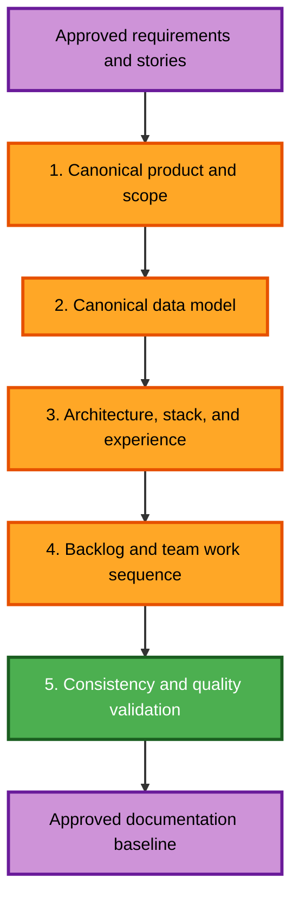

# Finance AI Documentation Reconciliation Execution Plan

## Objective

Create one internally consistent documentation baseline for a manual-first personal budgeting application with optional AI assistance deferred until after the complete manual MVP. This plan changes documentation only and creates no application code.

## Detailed Analysis Summary

### Change Impact Assessment

| Area | Impact |
|---|---|
| User-facing scope | High — the primary experience changes from chat-first AI capture to a normal manual budgeting application |
| Structural design | High — accounts, transfers, optional receipts, and user-owned catalogs alter the domain boundaries |
| Data model | High — the current receipt-as-header model is replaced and new Account, Transfer, and ExpenseItem concepts are required |
| Architecture | Medium/High — AI becomes a deferred adapter over existing forms rather than a core application path |
| Backlog | High — current HU numbering, story count, dependencies, and sprint assignments are stale |
| Security | Medium — authentication/session behavior and ownership requirements must be synchronized |
| Application code | None — explicitly outside this documentation workflow |

### Risk Assessment

- **Risk level:** High for consistency, low for operational impact because no application code exists.
- **Rollback complexity:** Easy through Git; each repair group will remain reviewable.
- **Validation complexity:** Moderate; the same decisions appear in multiple Markdown, SQL-reference, diagram, backlog, and mockup artifacts.
- **Primary risk:** Leaving two plausible but contradictory sources of truth.

## Source-of-Truth Hierarchy

When documents disagree during the repair, use this order:

1. `aidlc-docs/inception/requirements/requirements.md`
2. `aidlc-docs/inception/user-stories/stories.md`
3. `aidlc-docs/inception/user-stories/personas.md`
4. Repaired product documents under `docs/`
5. `SPRINT-PLAN.md` and Trello, which reference the approved story identifiers

## Repair Sequence

### Step 1 — Canonical Product and Scope

**Files:** `docs/CONTEXT.md`, `docs/ALCANCE.md`, `docs/FEATURES.md`

- [x] State clearly that the application works completely without AI.
- [x] Define the manual MVP: identity, preferences, accounts, currencies, catalogs, expenses, income, transfers, history, budgets, and dashboard.
- [x] Add accounts and transfers as core product concepts.
- [x] Move product AI after the complete manual MVP.
- [x] Describe AI as optional form-prefilling assistance with normal review/confirmation.
- [x] Remove Admin from the approved MVP.
- [x] Remove or defer chat history, agent actions, live conversion, calendar screen, and recurring transactions.
- [x] Align terminology: account, expense, expense item, receipt attachment, income, transfer, budget, and currency.

**Completion check:** A reader can explain the product and manual/AI boundary without consulting another file.

### Step 2 — Canonical Data Model

**Files:** `docs/SCHEMA.md`, `docs/schema.sql`

- [x] Add User-owned Account with name, type, currency, opening balance, and active/archived state.
- [x] Add Transfer with source account, destination account, source amount, destination amount, date, and atomic ownership rules.
- [x] Make Expense the spending transaction header.
- [x] Add optional ExpenseItem children.
- [x] Make receipt/image optional evidence associated with an expense.
- [x] Associate every expense and income entry with one account.
- [x] Make categories, subcategories, payment methods, and income sources user-owned; retain Currency as shared reference data.
- [x] Remove Role/Admin from the MVP schema.
- [x] Preserve original currencies and document separate totals until conversion exists.
- [x] Define archive/history behavior and uniqueness/index rules.
- [x] Correct SQL dependency order and redundant-index problems.
- [x] Label `schema.sql` as a non-authoritative design/reference snapshot because future SQLAlchemy models plus Alembic migrations will be executable truth.

**Completion check:** The documented model supports every manual story, especially account balances and transfers, without dummy receipts or AI dependencies.

### Step 3 — Architecture, Stack, and Experience Direction

**Files:** `docs/ARCHITECTURE.md`, `docs/STACK.md`, `docs/MOCKUPS.md`, `docs/step5-plan.md`

- [x] Reframe the core architecture around manual modules: Auth, Accounts, Catalogs, Expenses, Income, Transfers, Budgets, and Analytics.
- [x] Keep a modular monolith: Flutter client, FastAPI backend, PostgreSQL database.
- [x] Show AI Parsing/Assistant as a deferred optional adapter that produces the same form contracts.
- [x] Add manual expense and transfer data-flow diagrams.
- [x] Remove language that makes chat the required application shell.
- [x] Define the initial home as dashboard/activity with Add Expense, Add Income, and Transfer actions.
- [x] Add auth, account, manual form, history, budget, and dashboard screen specifications.
- [x] Mark the existing chat-first HTML prototype as an earlier concept that is not the approved manual-MVP source of truth; do not rewrite application/mockup code in this pass.
- [x] Remove the product AI key from manual-MVP setup requirements.
- [x] Record SQLAlchemy/Alembic, secure session, testing, and dependency-management decisions at the appropriate documentation level.

**Completion check:** Architecture and UX both work when no AI provider or API key exists.

### Step 4 — Product Backlog and Team Work Sequence

**Files:** `docs/BACKLOG-AND-STORIES.md`, `docs/SPRINT-PLAN.md`, `TASKS.md`

- [x] Make `BACKLOG-AND-STORIES.md` own PB/HU identifiers and synchronize HU-001 through HU-016.
- [x] Keep 14 manual-MVP stories before the 2 deferred AI stories.
- [x] Add EN-001 through EN-006 as technical enablers, not user stories.
- [x] Keep HU-001 focused on registration and remove project-wide setup from its story estimate.
- [x] Make `SPRINT-PLAN.md` reference the canonical HU and EN identifiers without renumbering them.
- [x] Sequence work by dependency: enablers → identity → accounts/catalogs → manual movements → budgets/dashboard → optional AI.
- [x] Remove the stale statement that only two stories exist.
- [x] Remove the stale sprint sequence that schedules photo AI before manual expense CRUD.
- [x] Update `TASKS.md` progress and add the documentation reconciliation decisions.
- [x] Document that story points remain a team Planning Poker decision after stories meet Definition of Ready.

**Completion check:** Repository documents and Trello can use the same stable identifiers with no duplicate numbering authority.

### Step 5 — Consistency and Quality Validation

**Files:** All repaired documents

- [x] Search for statements that make AI, chat, receipt images, Admin, or automatic conversion mandatory in the manual MVP.
- [x] Search for old HU numbering and obsolete sprint assignments.
- [x] Validate every Mermaid diagram and provide text alternatives.
- [x] Validate Markdown tables, links, code blocks, and special-character escaping.
- [x] Verify schema references are internally ordered and relationship descriptions agree.
- [x] Verify every manual story maps to product scope, data support, architecture, and a future implementation path.
- [x] Verify AI stories depend on the completed manual MVP and preserve manual fallback.
- [x] Verify security and partial property-testing requirements remain represented.
- [x] Review the final Git diff for unintended changes.
- [x] Confirm no backend/frontend application code or runtime project was created.

**Completion check:** A final contradiction search finds no active source-of-truth conflict.

## Workflow Visualization

### Text Alternative

1. Approved requirements and stories
2. Canonical product and scope
3. Canonical data model
4. Architecture, stack, and experience direction
5. Product backlog and team work sequence
6. Consistency and quality validation
7. Approved documentation baseline

## AI-DLC Stage Decisions

### INCEPTION

- [x] Workspace Detection — completed
- [x] Reverse Engineering — skipped because no application code exists
- [x] Requirements Analysis — completed and approved
- [x] User Stories — completed and approved
- [x] Workflow Planning — plan generated; user approval pending
- [ ] Application Design — execute through Steps 1–3 of this documentation repair
- [ ] Units Generation — execute through Step 4 by mapping stories and enablers into dependency-ordered work

### CONSTRUCTION

- [ ] Functional Design — deferred until the team selects the first implementation unit
- [ ] NFR Requirements/Design — deferred; current cross-cutting requirements remain documented
- [ ] Infrastructure Design — deferred until construction is authorized
- [ ] Code Generation — outside this documentation-only request
- [ ] Build and Test — outside this documentation-only request

### OPERATIONS

- [ ] Operations — deferred; placeholder only

## Security and Testing Compliance for This Plan

### Security Baseline

- Applicable documentation requirements cover secure authentication, input validation, ownership, safe errors/logs, dependency management, and atomic operations.
- Production deployment controls remain N/A until a deployment target exists.
- No blocking documentation-planning finding is open.

### Property-Based Testing — Partial Mode

- The plan preserves required future coverage for serialization round trips, transfer/balance invariants, domain generators, reproducibility, and Hypothesis configuration.
- No application tests are created in this documentation-only pass.
- No blocking documentation-planning finding is open.

## Success Criteria

- All active product documents describe the same manual-first application.
- Accounts and transfers exist consistently in scope, schema, architecture, stories, and sprint sequence.
- Manual expense/income flows do not depend on receipts or AI.
- AI is optional, deferred, and limited to proposals for existing forms.
- HU-001 through HU-016 and EN-001 through EN-006 have one numbering authority.
- The old schema-order issue and conflicting Admin/currency/chat decisions are resolved.
- No application code is created.

## Starting Point

All five documentation-repair steps passed validation on 2026-08-27. Construction remains outside this workflow; begin only after the team reviews this baseline and explicitly authorizes the foundation/HU-001 work package.

## Completion Record

- 16 canonical user stories and 6 technical enablers synchronized.
- 13 reference-schema tables checked for creation/reference order.
- 7 current product/workflow Mermaid diagrams paired with 7 text alternatives.
- Active Markdown code fences, tables, and local links passed static validation.
- Legacy AI-first examples were marked historical or aligned with the current source-of-truth hierarchy.
- Git diff review found documentation artifacts only; no backend, frontend, Compose, or runtime project exists.
