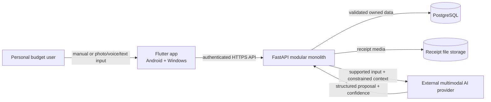
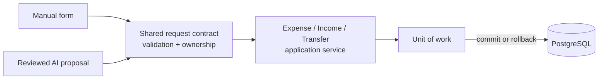
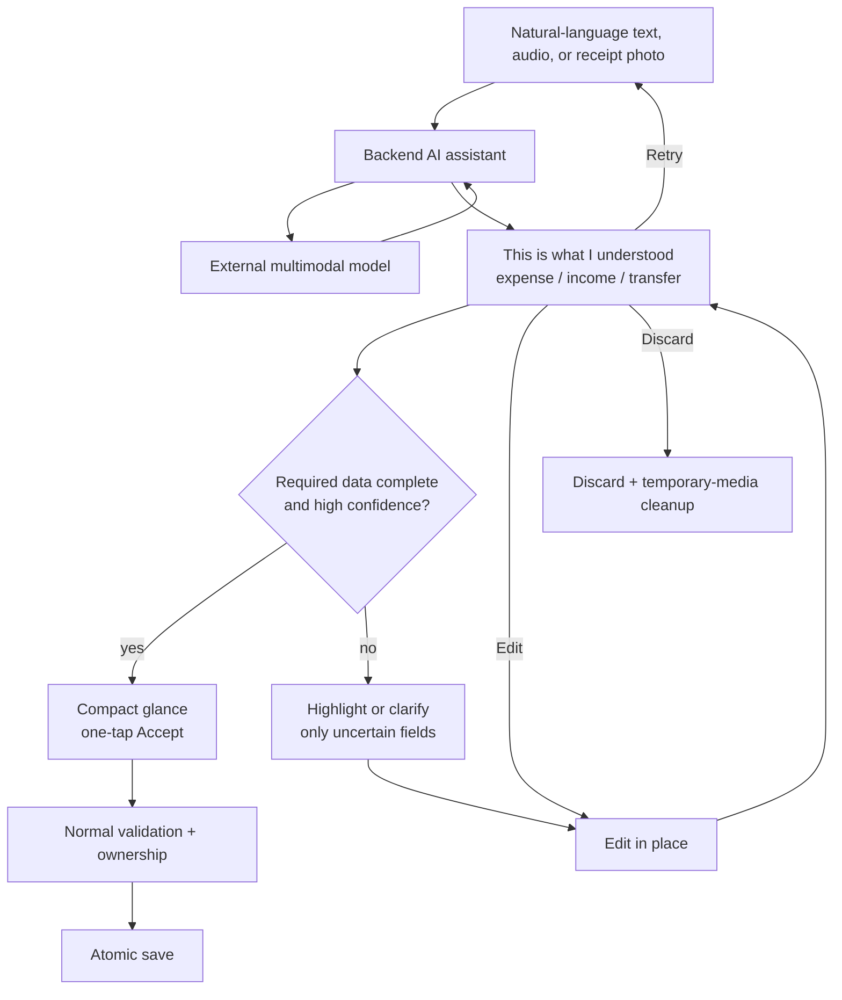

# Architecture — Finance AI

## Direction

Finance AI is a modular monolith with a shared Flutter Android/Windows client, a FastAPI backend, PostgreSQL, and backend-managed receipt storage.

The architecture separates two concerns:

- The deterministic foundation owns identity, accounts, catalogs, transaction rules, persistence, activity, and analytics.
- The AI assistant accelerates input by turning natural text, audio, or a receipt photo into an untrusted proposal for those same operations.

AI is integrated after HU-001–HU-012, including transaction history and the basic dashboard, are stable. It does not wait for budgets, and it never writes around the deterministic application services.

## System Context

Only the backend accesses PostgreSQL, file storage, or the AI provider. Provider credentials never exist in the client.

## Backend Modules

| Module | Responsibility |
|---|---|
| Identity and Sessions | Registration, login, renewal, restoration, logout, and current user |
| Accounts and Currencies | Money locations, original currency, and balance rules |
| Catalogs | Categories, stores, income sources, and confirmed deletion |
| Purchases | Receipt/purchase groups with one or more expense rows and optional images |
| Income | Manual income lifecycle |
| Transfers | Atomic movement between two owned accounts |
| Transaction History | Searchable owned expense, income, and transfer history with filters |
| Dashboard | Deterministic balances, recent movements, income/expense, and category summaries |
| Budgets | Weekly/monthly targets and progress added to the dashboard |
| AI Assistant | Multimodal intent/extraction and confidence-aware proposals |

All persistence-changing modules use application services and a unit-of-work boundary. Repositories never commit independently.

## Deterministic Save Boundary

There is one financial-write path per transaction type. AI never creates a second one.

## Fast AI-Assisted Flow

Confidence controls presentation friction, not business rules. A high-confidence result is fast to accept; a low-confidence result receives focused review. Both use the same validation and save service.

## Catalog Deletion

Category deletion runs in one unit of work:

1. Verify ownership and explicit confirmation.
2. Null the classification on affected expenses so they become Uncategorized.
3. Delete budgets targeting the removed classification.
4. Delete the requested catalog record.
5. Commit all changes or roll back all changes.

Store and income-source deletion clears historical optional references before deleting the catalog value.

## Security and Reliability

- Deny unauthenticated access by default.
- Scope every owned lookup by the authenticated user.
- Keep passwords, credentials, secrets, raw financial inputs, and receipt contents out of logs.
- Use short-lived access credentials and rotating renewable credentials stored securely on the client.
- Apply bounded validation and generic errors.
- Roll back multi-record operations completely on failure.
- Remove temporary AI media after discard, failure, or expiration.
- Bound receipt images to approved formats/sizes and audio recordings to approved formats and 60 seconds.
- Keep manual entry available when the provider is unavailable.

## Repository Ownership

- `finance-ai`: product documentation, decisions, architecture, and orchestration
- `finance-ai-backend`: FastAPI, PostgreSQL models/migrations/seeds, OpenAPI, and backend tests
- `finance-ai-frontend`: shared Flutter Android/Windows client and client tests
