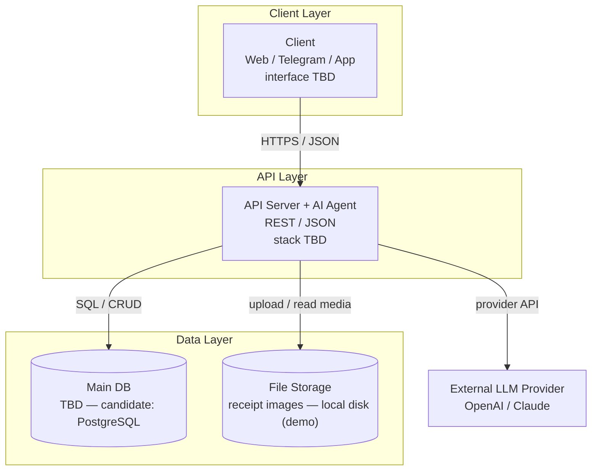
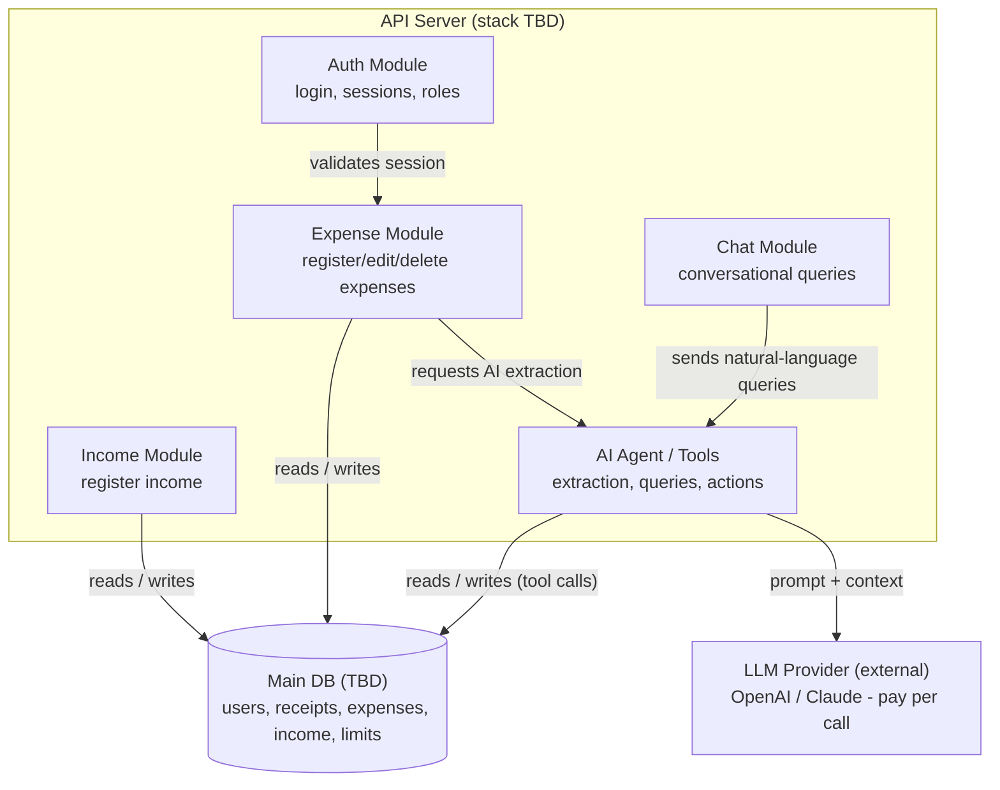
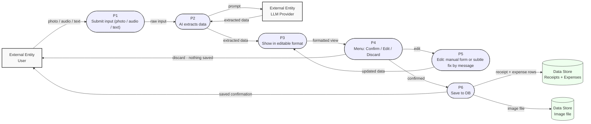
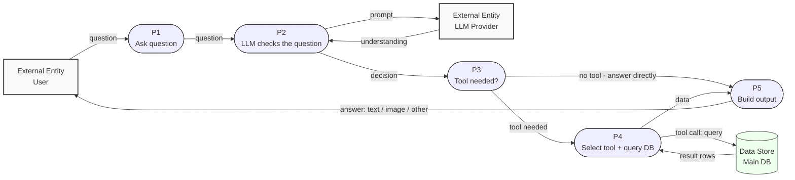

# Architecture — Finance AI Tracker

> **Status:** PROPOSAL — interface-agnostic. The stack and interface are not decided yet
> (professor decides); everything here is the contract, not the implementation.
> Decisions source: `docs/step5-plan.md` (Q1–Q7). Guide: `docs/guides/architecture-diagrams-guide.md`.

## Pending decisions (TBD)

- **Interface** — web / Telegram / app (professor decides)
- **Tech stack** — backend language/framework; DB candidate: PostgreSQL (professor decides)
- **Price source** — Phase 3 supermarket price feature ("to define")

When these are decided, resolve them via TASKS.md **Step 8** (post-stack sweep).

---

## Layer diagram

One subgraph per layer, `[( )]` databases, labeled arrows, TBD where open.

> *Technologies TBD — this diagram is the contract, not the implementation.*

Notes:

- The AI agent is **merged inside the API** (Q3 decision) — no separate AI layer.
- LLM provider is external (outside the system boundary, Q2).
- Agent write-back distinction (limits, subcategories) is shown at module level in the component diagram.
- No vector DB, no cache (Q5: not needed — structured DB via tool calls).
- Admin deliberately excluded (Q1 decision).

---

## Component diagram

The inside view of the API container — the 5 modules and how they relate. The agent→DB arrow here carries the "agent writes limits/subcategories" story (deferred from the layer diagram to this zoom level).

> Uses `flowchart` instead of `C4Component` so it renders in Zed / GitHub mermaid preview. See the guide §6 note on the Zed gotcha with experimental C4C diagrams.

Legend:

- Box (subgraph) = the API container (its 5 modules inside).
- `[( )]` cylinder = data store (Main DB).
- Plain box outside the subgraph = external entity (LLM provider).

Notes:

- Only the API is expanded; the Client, DB, and File Storage stay as in the layer diagram.
- LLM provider is external — outside our system boundary (Q2).
- The agent → DB edge ("reads / writes (tool calls)") is where the agent acts on data (creates limits, generates subcategories) — the signature feature shown at this zoom level.
- `TBD` on every technology — stack not decided yet (Step 8 sweep).
- Admin deliberately excluded (Q1 decision).

---

## Data flow

Two journeys (Q6). Conventions per guide §7: entity = rectangle, process = stadium `([ ])`, store = cylinder `[( )]`, every flow labeled. DFD 2 is read-only — agent writes are Phase 3 (see `docs/ALCANCE.md` "Data Protection").

### DFD 1 — Register an expense

Note: **delete** (post-save) exists separately — this diagram covers the pre-save flow; saved expenses can always be edited or deleted (ALCANCE.md).

### DFD 2 — Ask the AI

Note: this journey is **read-only**. Agent writes (create limits, subcategories) are Phase 3 and go through the confirmation preview — see `docs/ALCANCE.md` "Data Protection".
