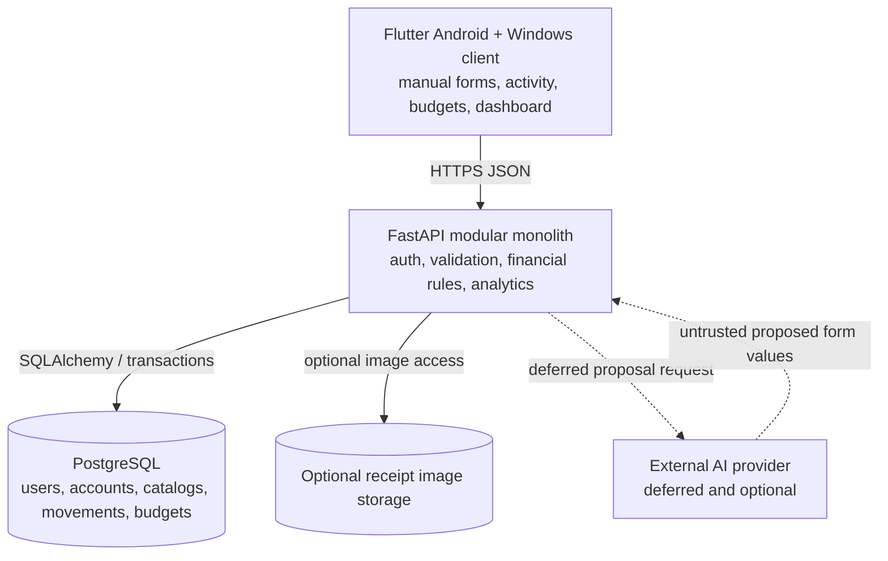
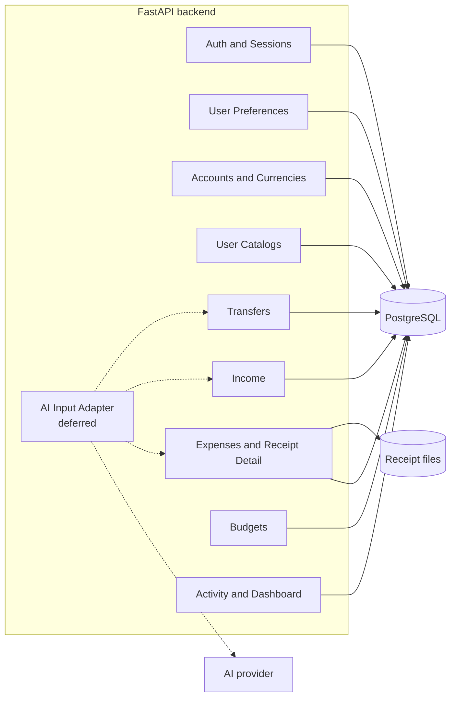
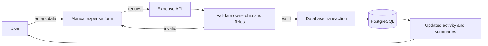
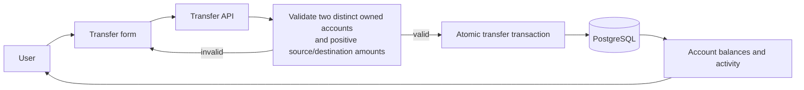
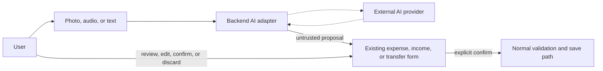

# Architecture — Finance AI

## Status

Approved manual-first direction for the university prototype. The system is a modular monolith composed of a Flutter client, FastAPI backend, PostgreSQL database, and optional local receipt-image storage.

Product AI is a deferred adapter. The manual application does not require an AI provider or API key.

## Architectural Principles

- Backend owns financial rules, authorization, persistence, and analytics.
- Flutter owns presentation and local interaction state, not financial truth.
- PostgreSQL stores structured user-owned data.
- Transfers are atomic and do not affect income/expense analytics.
- Original currencies are preserved and incompatible currencies are not silently combined.
- Manual forms are the canonical write interface.
- Later AI proposes values for those forms and never writes directly.
- The MVP remains one deployable backend rather than separate microservices.

## Layer Diagram

### Text Alternative

The Flutter app calls the FastAPI backend. The backend reads/writes PostgreSQL and optionally stores receipt images. Only after the manual MVP, the backend may call an external AI provider and receive proposed form values.

## Backend Modules

### Text Alternative

The backend contains feature modules for authentication, preferences, accounts/currencies, catalogs, expenses, income, transfers, budgets, and analytics. A deferred assistant module can propose inputs to expense, income, or transfer modules but cannot bypass them.

## Module Responsibilities

| Module | Responsibility |
|---|---|
| Auth and Sessions | Registration, login, short-lived access credentials, renewable-session revocation, current user |
| User Preferences | Preferred defaults such as COP |
| Accounts and Currencies | Owned money locations, currency association, balance calculations |
| User Catalogs | Categories, subcategories, payment methods, and income sources |
| Expenses | Manual expense CRUD, optional item detail, optional receipt attachment |
| Income | Manual income CRUD |
| Transfers | Atomic movement between two owned accounts |
| Budgets | Weekly/monthly category or subcategory targets and progress |
| Activity and Dashboard | User-scoped history, filters, balances, and deterministic summaries |
| AI Input Adapter — deferred | Converts supported photo/audio/text into untrusted proposals for existing forms |

## Core Data Flow — Manual Expense

### Text Alternative

The user fills the normal expense form. The backend validates the owned account/catalog fields and saves the expense in a transaction. Success updates activity, balances, budgets, and dashboard calculations. Invalid input returns to the form without saving.

## Core Data Flow — Transfer

### Text Alternative

The user selects two distinct owned accounts and provides transfer amounts. The backend validates ownership/currency rules and commits both sides atomically. The movement changes account balances and activity but not income or expense totals.

## Deferred Data Flow — AI-Assisted Input

### Text Alternative

The backend sends optional input to an external provider. The returned values prefill an existing form. The user must review and explicitly confirm before the normal validation/save path runs.

## Security Boundaries

- Registration and login are the only public business endpoints.
- Financial endpoints deny access by default and validate the authenticated owner.
- Native client tokens use secure platform storage on each supported platform.
- Passwords, tokens, secrets, and unnecessary financial content are excluded from logs.
- AI-provider keys exist only in backend configuration and are absent from manual-MVP setup.
- File access is mediated by the backend; clients never submit arbitrary server paths.
- Errors fail closed and return generic user-safe messages.

## Deployment Direction

For development/demo:

- Flutter app runs on an emulator/device.
- FastAPI and PostgreSQL run locally through Docker Compose.
- PostgreSQL is attached only to an internal private network and has no host port.
- FastAPI also joins a client-access bridge and publishes only to Windows loopback (`127.0.0.1:8000`).
- An opt-in development override may temporarily attach PostgreSQL to the client-access bridge at `127.0.0.1:55432` for DBeaver. It uses a database-enforced read-only role and password-hash-free views; it is absent from the default topology.
- Optional receipt files use a backend-controlled local volume.

A VM may host the backend/database later. Production networking, managed encryption, monitoring, backup, and recovery are deferred until the team approves a deployment target.
