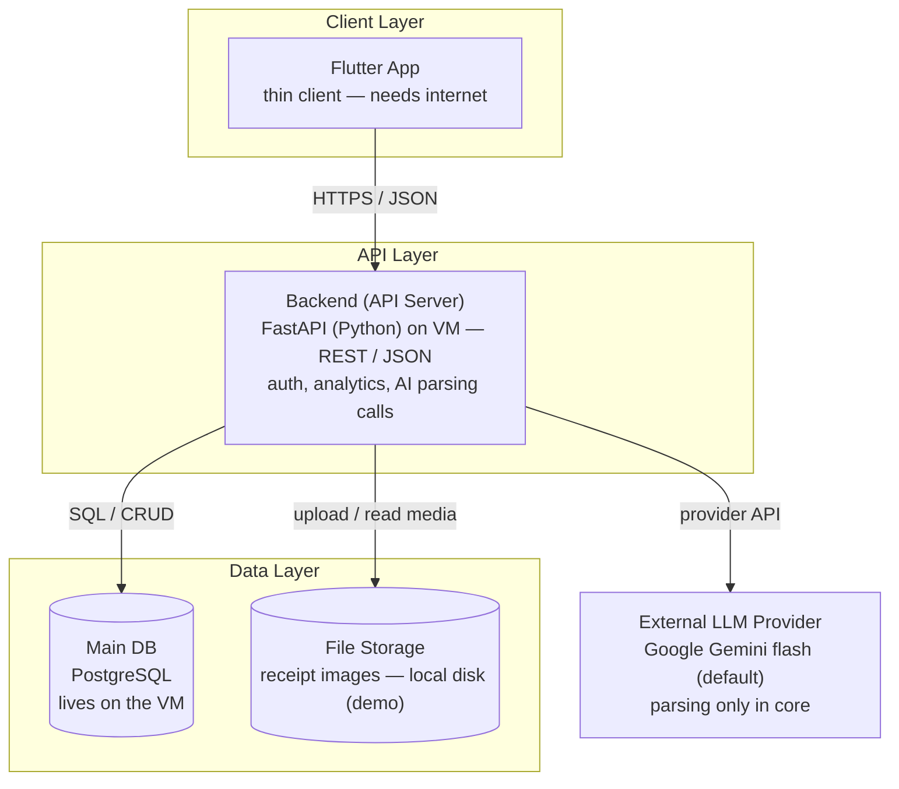
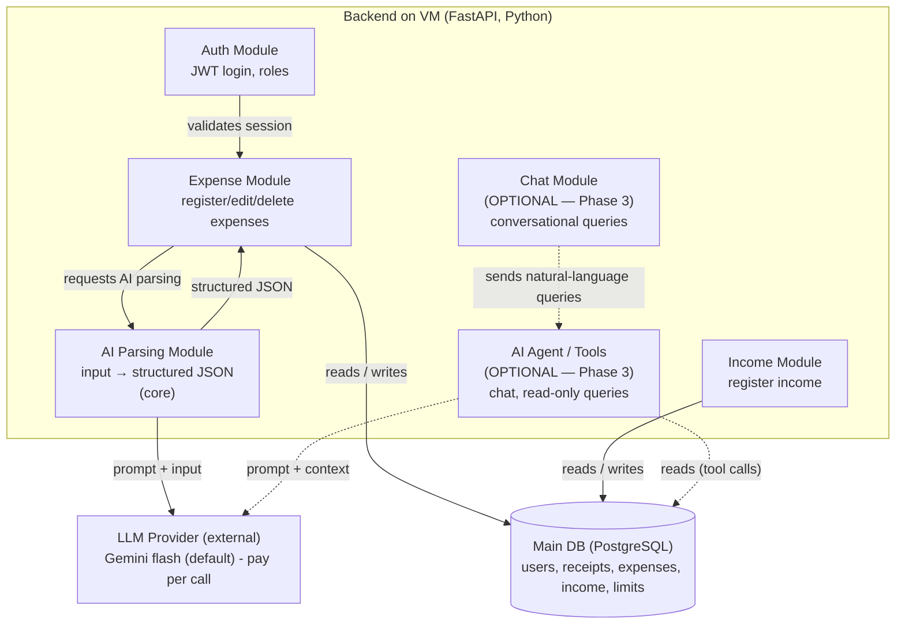
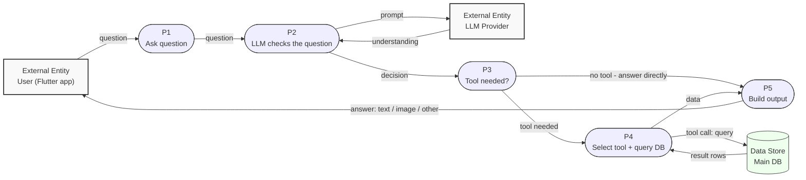

# Architecture — Finance AI Tracker

> **Status:** PROPOSAL — core is the Flutter app + backend (API + DB). The "agent" features
> (chat, AI acting on data) are optional Phase 3 ideas and are marked as such below.
> Decisions source: `docs/step5-plan.md` (Q1–Q7). Guide: `docs/guides/architecture-diagrams-guide.md`.
> Code architecture & layers guide: `docs/guides/code-architecture-guide.md`.
> Stack decisions: `docs/STACK.md`.

## Pending decisions (TBD)

- **Interface** — **Flutter app** (team proposal; professor confirmation pending — see `docs/STACK.md`)
- **Price source** — Phase 3 optional supermarket price feature ("to define"), only if Phase 3 is built

Stack (backend FastAPI, PostgreSQL, Gemini flash default) is decided in `docs/STACK.md`.
Anything the professor changes at semester start gets resolved via TASKS.md **Step 8** (post-stack sweep).

---

## Layer diagram

One subgraph per layer, `[( )]` databases, labeled arrows, TBD where open.

> *Technologies decided in `docs/STACK.md` (Flutter · FastAPI · PostgreSQL · Gemini flash default) — this diagram is the contract.*

Notes:

- The AI logic is **merged inside the backend** (Q3 decision) — no separate AI layer.
- In the core, the LLM provider is used **only for AI-assisted input parsing** (photo/audio/natural-language text → structured JSON). The manual form bypasses AI, and the phone never calls the LLM directly.
- The **agent (chat + AI acting on data)** is optional Phase 3 — if built, it lives inside the backend too. Marked optional in the component diagram.
- LLM provider is external (outside the system boundary, Q2).
- No vector DB, no cache (Q5: not needed — structured DB via tool calls).
- Admin deliberately excluded (Q1 decision).

---

## Component diagram

The inside view of the backend container — the modules and how they relate. The **AI Parsing** module is core; the **Chat / Agent** modules are optional Phase 3 (dashed, marked optional).

> Uses `flowchart` instead of `C4Component` so it renders in Zed / GitHub mermaid preview. See the guide §6 note on the Zed gotcha with experimental C4C diagrams.

Legend:

- Box (subgraph) = the backend container (its modules inside).
- `[( )]` cylinder = data store (Main DB).
- Plain box outside the subgraph = external entity (LLM provider).
- Dashed edges + "(OPTIONAL — Phase 3)" = agent/chat modules, not built in the core.

Notes:

- Only the backend is expanded; the Flutter app, DB, and File Storage stay as in the layer diagram.
- LLM provider is external — outside our system boundary (Q2).
- **Core:** the only LLM interaction is `parsing → llm → structured JSON`. No agent, no writes.
- **Optional Phase 3:** the agent → DB edge ("reads (tool calls)") is where the chat agent queries data — read-only. Agent *writes* (limits, subcategories) would go through a confirmation preview (ALCANCE.md "Data Protection").
- Stack decided in `docs/STACK.md` (FastAPI, PostgreSQL, Gemini flash default).
- Admin deliberately excluded (Q1 decision).

---

## Data flow

Two journeys (Q6). Conventions per guide §7: entity = rectangle, process = stadium `([ ])`, store = cylinder `[( )]`, every flow labeled.

### DFD 1 — Register an expense (CORE)

Note: **delete** (post-save) exists separately — this diagram covers the pre-save flow; saved expenses can always be edited or deleted (ALCANCE.md). Manual form entry skips P2/LLM entirely.

### DFD 2 — Ask the AI (OPTIONAL — Phase 3, not built in core)

Note: this journey is **optional (Phase 3) and read-only**. Agent writes (create limits, subcategories) would go through the confirmation preview — see `docs/ALCANCE.md` "Data Protection". The core app gets its analytics from the backend via plain SQL endpoints (the Dashboard), not through this flow.
