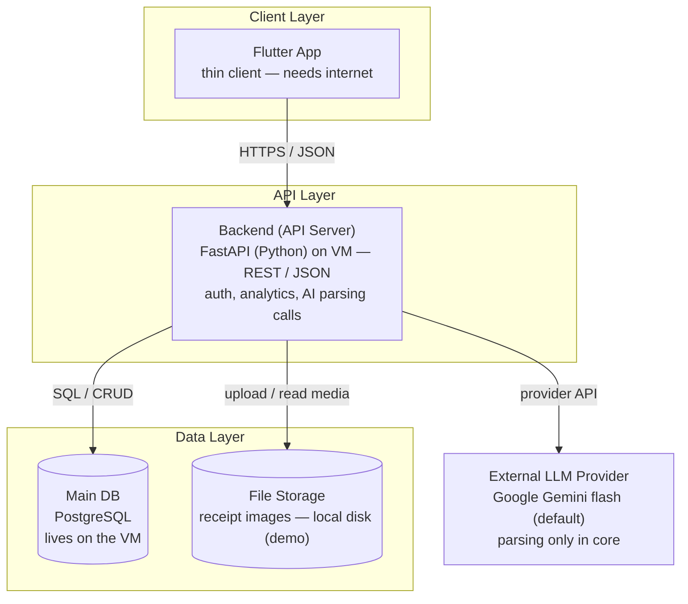
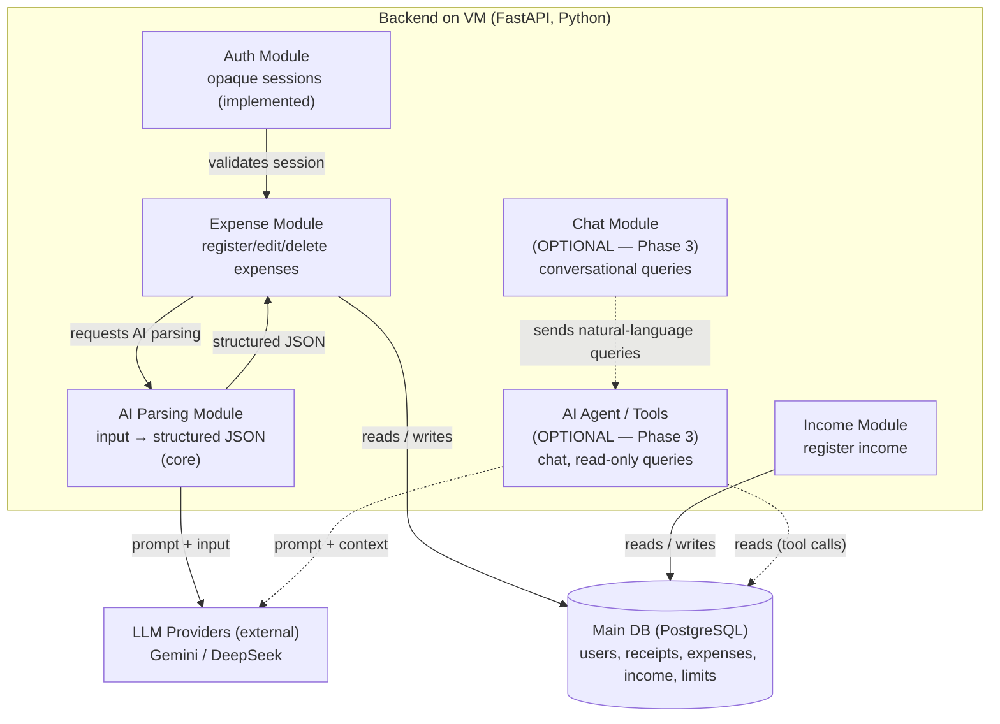
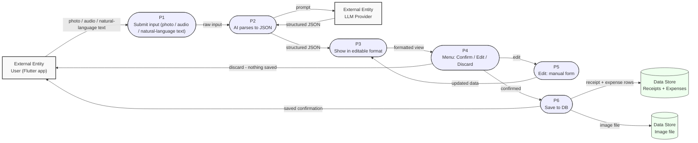

# Architecture — Finance AI Tracker

> **Original status:** PROPOSAL — core is the Flutter app + backend (API + DB). The "agent"
> features (chat, AI acting on data) remain optional Phase 3 ideas and are marked below.
> Decisions source: `docs/step5-plan.md` (Q1–Q7). Guide: `docs/guides/architecture-diagrams-guide.md`.
> Code architecture & layers guide: `docs/guides/code-architecture-guide.md`.
> Stack decisions: `docs/STACK.md`.

> **Current implementation (2026-10-20):** source snapshot: backend `origin/develop` `1fae699`,
> frontend `origin/develop` `a23a8a6`. This file began as a proposal. The Mermaid diagrams below
> preserve the initial deployment and component views, along with optional Phase 3 flows; they are
> historical sketches, not a complete representation of the current runtime or formal UML. The
> implemented architecture is summarized below, with source citations in the tracked
> [code architecture and layers guide](guides/code-architecture-guide.md).

The implemented backend is one modular FastAPI application: `/api/v1` routers delegate to
authentication, financial services, text capture and receipt capture. Services use SQLAlchemy
repositories and units of work for PostgreSQL. Gemini and DeepSeek are external providers behind
text and vision gateways, with fallback conditional on configuration. Capture produces a proposal;
only an explicit confirmation creates the financial operation. Flutter owns navigation, presentation,
session state, HTTP repositories and the local encrypted cache of confirmed receipt photos.
Android speech recognition produces text locally before the text-proposal flow. The backend processes
receipt image bytes in memory and does not persist the uploaded photo as a server file.

For implementation evidence, see the verified backend and frontend source links in the
[code architecture and layers guide](guides/code-architecture-guide.md).

## Academic decisions from the original plan

- **Interface** — **Flutter app** is implemented. The original plan recorded professor confirmation
  as pending; implementation does not itself establish academic approval (see `docs/STACK.md`).
- **Price source** — Phase 3 optional supermarket price feature ("to define"), only if Phase 3 is built

The original FastAPI, PostgreSQL and Gemini decision is recorded in `docs/STACK.md`, which also
describes the implemented stack. TASKS.md **Step 8** was the original post-stack academic sweep;
this technical audit does not decide its approval status.

---

## Layer diagram (initial deployment proposal)

One subgraph per layer, `[( )]` databases, labeled arrows, TBD where open.

> *Original design contract: Flutter · FastAPI · PostgreSQL · Gemini flash default, as recorded
> in `docs/STACK.md`. This VM/file-storage sketch is not the current deployment topology.*

Notes:

- The AI logic is **merged inside the backend** (Q3 decision) — no separate AI layer.
- In the implemented capture flow, the backend sends text or receipt images to a configured external
  provider for extraction. Android speech recognition is local and sends its transcript through
  text capture. The manual form bypasses AI, and the phone does not call the LLM directly.
- The **agent (chat + AI acting on data)** is optional Phase 3 — if built, it lives inside the backend too. Marked optional in the component diagram.
- LLM provider is external (outside the system boundary, Q2).
- No vector DB is part of the implemented capture path. The Flutter client does keep an encrypted
  local cache of confirmed receipt photos; the older "no cache" decision did not account for it.
- Admin deliberately excluded (Q1 decision).

---

## Component diagram (initial proposal)

This older inside view of the backend preserves the initial design. Its coarse module boundaries
do not describe all implemented services or provider gateways. For the current module structure,
capture gateways and confirmation flow, use the implementation summary above and source citations
in the [code architecture and layers guide](guides/code-architecture-guide.md). The **Chat / Agent**
modules remain optional Phase 3 proposals.

> Uses `flowchart` instead of `C4Component` so it renders in Zed / GitHub mermaid preview. See the guide §6 note on the Zed gotcha with experimental C4C diagrams.

Legend:

- Box (subgraph) = the backend container (its modules inside).
- `[( )]` cylinder = data store (Main DB).
- Plain box outside the subgraph = external entity (LLM provider).
- Dashed edges + "(OPTIONAL — Phase 3)" = agent/chat modules, not built in the core.

Notes:

- Only the backend is expanded; the Flutter app, DB, and File Storage stay as in the layer diagram.
- LLM provider is external — outside our system boundary (Q2).
- **Core:** provider extraction returns structured proposals. Proposal records may be stored
  temporarily; financial writes require explicit confirmation. No autonomous agent is implemented.
- **Optional Phase 3:** the agent → DB edge ("reads (tool calls)") is where the chat agent queries data — read-only. Agent *writes* (limits, subcategories) would go through a confirmation preview (ALCANCE.md "Data Protection").
- Stack decided in `docs/STACK.md` (FastAPI, PostgreSQL, Gemini flash default).
- Admin deliberately excluded (Q1 decision).

---

## Data flow

Two journeys (Q6). Conventions per guide §7: entity = rectangle, process = stadium `([ ])`, store = cylinder `[( )]`, every flow labeled.

### DFD 1 — Register an expense (initial proposal)

This DFD is a historical process sketch. In the implementation, proposal endpoints are separate
from confirmation endpoints; photo bytes are processed in memory by the backend, and the confirmed
photo is cached locally by Flutter. Its image-file store below represents the original VM design.

Note: **delete** (post-save) exists separately — this diagram covers the pre-save flow; saved expenses can always be edited or deleted (ALCANCE.md). Manual form entry skips P2/LLM entirely.

### DFD 2 — Ask the AI (OPTIONAL — Phase 3, not built in core)

Note: this journey is **optional (Phase 3) and read-only**. Agent writes (create limits, subcategories) would go through the confirmation preview — see `docs/ALCANCE.md` "Data Protection". The core app gets its analytics from the backend via plain SQL endpoints (the Dashboard), not through this flow.
