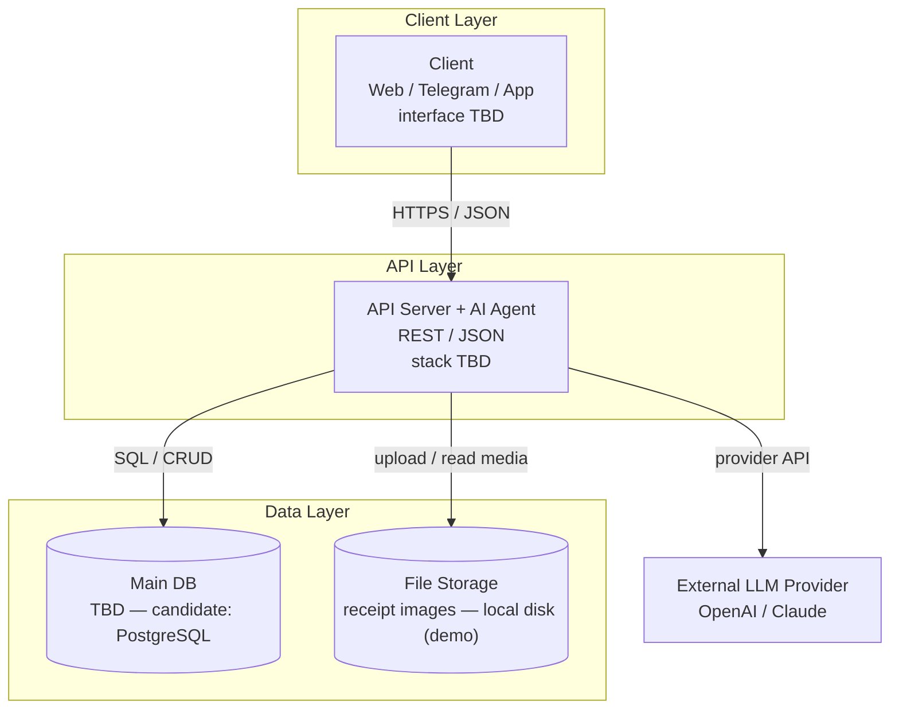

# Architecture — Finance AI Tracker

> **Status:** PROPOSAL — interface-agnostic. The stack and interface are not decided yet
> (professor decides); everything here is the contract, not the implementation.
> Decisions source: `docs/step5-plan.md` (Q1–Q7). Guide: `docs/guides/architecture-diagrams-guide.md`.

## Pending decisions (TBD)

- **Interface** — web / Telegram / app (professor decides)
- **Tech stack** — backend language/framework; DB candidate: PostgreSQL (professor decides)
- **Price source** — Phase 3 supermarket price feature ("to define")

When these are decided, resolve them via TASKS.md **Step 8** (post-stack sweep).

---

## Layer diagram

One subgraph per layer, `[( )]` databases, labeled arrows, TBD where open.

> *Technologies TBD — this diagram is the contract, not the implementation.*

Notes:

- The AI agent is **merged inside the API** (Q3 decision) — no separate AI layer.
- LLM provider is external (outside the system boundary, Q2).
- Agent write-back distinction (limits, subcategories) is shown at module level in the component diagram.
- No vector DB, no cache (Q5: not needed — structured DB via tool calls).
- Admin deliberately excluded (Q1 decision).

---

## Component diagram

*Pending — Stage 4.*

---

## Data flow

*Pending — Stage 5: DFD 1 (register expense) + DFD 2 (ask the AI).*
