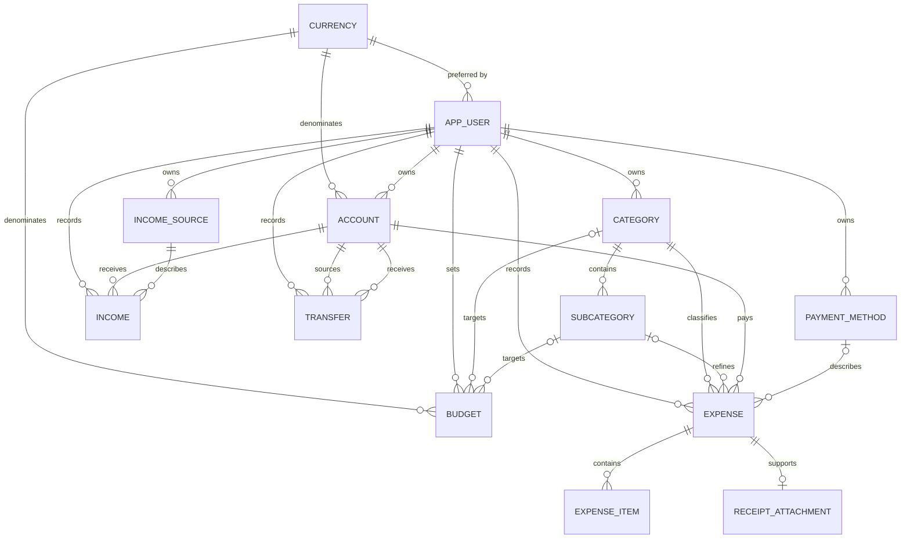

# Database Schema — Finance AI

## Status and Authority

This document is the approved conceptual/analysis data model for the manual MVP.

During construction:

- SQLAlchemy models define the application persistence model.
- Alembic migrations are the executable source of truth.
- `docs/schema.sql` is a non-authoritative PostgreSQL design/reference snapshot for review and diagram tools.
- Repeatable seed logic creates shared currencies and copies user-owned default catalogs during registration.

## Core Modeling Decisions

1. An **Account** is a place where one user holds money.
2. An **Expense** is the spending transaction header.
3. **ExpenseItem** rows and a **ReceiptAttachment** are optional detail.
4. An **Income** entry adds money to one account.
5. A **Transfer** moves money between two accounts and is neither income nor expense.
6. Every financial resource is user-owned.
7. Currency is stored on the account; original amounts are never rewritten.
8. Categories, subcategories, payment methods, and income sources are user-owned.
9. Archived references preserve history while preventing new selection.
10. The MVP has no Role/Admin model.

## Entity Relationship Diagram



### Text Alternative

- A user owns accounts, catalogs, expenses, income, transfers, and budgets.
- A currency can be selected by users and assigned to accounts/budgets.
- An account has many expenses and income entries and can be either side of transfers.
- A category has subcategories and classifies expenses or budgets.
- An expense can have optional item rows and at most one receipt attachment.
- A transfer references two distinct accounts belonging to the same user.

## Entities

### Currency

Shared reference list.

| Field | Rule |
|---|---|
| id | Primary key |
| code | Required unique ISO-style code, initially COP and USD |
| name | Required display name |
| decimals | Required non-negative display precision |
| is_active | Controls availability for new accounts/budgets |

### AppUser

| Field | Rule |
|---|---|
| id | Primary key |
| email | Required, normalized, unique |
| password_hash | Required adaptive hash; never plaintext |
| preferred_currency_id | Required Currency FK; registration uses COP |
| is_active | Account availability |
| created_at / updated_at | Audit timestamps |

There is no Admin role in the MVP.

### Account

Represents cash, bank, digital-wallet, savings, or another money location.

| Field | Rule |
|---|---|
| id | Primary key |
| user_id | Required owner |
| name | Required; unique among the user's active accounts |
| account_type | cash, bank, digital_wallet, savings, or other |
| currency_id | Required; account amounts use this currency |
| opening_balance | Required; defaults to zero |
| is_active | Archived accounts remain in history |
| created_at / updated_at | Audit timestamps |

Balance is derived from opening balance, income, expenses, and transfers. A mutable stored balance is not the canonical truth.

### Category and Subcategory

Both are user-owned. Subcategory belongs to one category of the same user.

Archived values remain attached to old records but are excluded from new-entry selectors.

### PaymentMethod and IncomeSource

User-owned supporting catalogs. Common templates are copied during registration and can be customized or archived.

### Expense

Represents one spending transaction.

| Field | Rule |
|---|---|
| id | Primary key |
| user_id | Required owner |
| account_id | Required owned Account |
| category_id | Required owned Category |
| subcategory_id | Optional; must belong to the selected Category and user |
| payment_method_id | Optional owned PaymentMethod |
| amount | Required positive amount in Account currency |
| date | Required transaction date |
| merchant | Optional merchant/place |
| description | Required short description |
| reason | Optional context |
| is_archived | Archived expenses are excluded from active calculations |
| created_at / updated_at | Audit timestamps |

### ExpenseItem

Optional detail row under an Expense.

| Field | Rule |
|---|---|
| id | Primary key |
| expense_id | Required Expense FK |
| name | Required |
| quantity | Required positive value; defaults to one |
| amount | Required non-negative row amount |
| reason | Optional item context |

The Expense amount remains authoritative even when item rows sum differently.

### ReceiptAttachment

Optional evidence for an Expense.

| Field | Rule |
|---|---|
| id | Primary key |
| expense_id | Required and unique; at most one attachment per expense in the MVP |
| file_path | Backend-managed path, never arbitrary client filesystem access |
| content_type | Supported image type |
| created_at | Upload timestamp |

- **Receipt is required**: Every expense belongs to a receipt. Even simple expenses (e.g., "I spent $15 on lunch") create a minimal receipt (store = "Manual", image = null). The receipt belongs to a user directly (`user_id`) — this matches the index on `receipt.user_id`.
- **Ownership consistency**: `Expense.user_id` and `Receipt.user_id` must always reference the same user. Enforced by the application, not a DB constraint (checked during review).
- **Image is a file path**: `receipt.image` stores a path/URL (`TEXT`), not the binary itself — keeps the DB light; the image file lives on disk/object storage.
- **Total is stored**: for a photographed receipt, `total` is the printed receipt total (the truth) and may differ from the sum of items because of taxes, discounts, or rounding. For manual multi-item entry, `total` is the sum of item amounts; for AI-assisted text/audio, the single parsed amount is both the item amount and receipt total.
- **Payment methods**: Separate entity (PaymentMethod — Cash, Card, Transfer, Nequi...) for scalability — adding a new method needs no code change.
- **Flexible model**: Handles both simple expenses ("spent $15 on lunch") and detailed receipts (individual items extracted by AI from photo)
- **Currency**: Master list of supported currencies. The Receipt stores the purchase currency (`currency_id` — one purchase = one currency). The User sets a preferred display currency (`preferred_currency_id`), stored on the User row; conversion happens on-the-fly for display only, never stored (if unset, the app falls back to COP). Original amount and original currency are always kept as the truth.
- **Category hierarchy**: Expense links to Subcategory (required, "No subcategory" default per category). Category is derived through the subcategory's parent. No direct category link on Expense.
- **Reason (hybrid approach)**: Receipt has `purchase_reason` (applies to the whole purchase, e.g., "weekly groceries"). Expense has `item_reason` (optional, specific to that item, e.g., "it was on discount"). If `item_reason` is null, the expense inherits `purchase_reason` from the receipt.
- **Income**: Registered separately from expenses, with its own source list (IncomeSource — Work, Freelance, Gift...). Optional `description` instead of a reason. Currency follows the same rule as receipts (store original, convert on display). Enables balance analysis ("am I spending more than I earn?").
- **SpendingLimit target (XOR rule)**: A limit is one rule with one target. Both `subcategory_id` and `category_id` set would make it ambiguous (e.g., Food + Eating out could mean "all Food", "Eating out only", or double-count Eating out) — so the UI prevents it and the database enforces exactly one via a CHECK constraint.
- **SpendingLimit currency**: Limit amounts are in the user's preferred currency — a limit is a personal target, not a purchase, so no per-limit currency.
- **SpendingLimit**: Phase 3 feature, included in domain design for completeness

### Income

| Field | Rule |
|---|---|
| id | Primary key |
| user_id | Required owner |
| account_id | Required owned Account |
| income_source_id | Required owned IncomeSource |
| amount | Required positive amount in Account currency |
| date | Required date |
| description | Optional |
| is_archived | Archived income is excluded from active calculations |
| created_at / updated_at | Audit timestamps |

### Transfer

| Field | Rule |
|---|---|
| id | Primary key |
| user_id | Required owner |
| source_account_id | Required owned Account |
| destination_account_id | Required distinct owned Account |
| source_amount | Required positive amount in source currency |
| destination_amount | Required positive amount in destination currency |
| date | Required date |
| description | Optional |
| is_archived | Supports future correction/history policy |
| created_at / updated_at | Audit timestamps |

Same-currency transfers should use equal source/destination amounts. Cross-currency transfers store both actual amounts. The application enforces this currency-aware rule within one database transaction.

### Budget

| Field | Rule |
|---|---|
| id | Primary key |
| user_id | Required owner |
| currency_id | Required Currency FK |
| amount | Required positive target |
| period | weekly or monthly |
| category_id | Optional owned Category |
| subcategory_id | Optional owned Subcategory |
| is_active | Controls current use |
| created_at / updated_at | Audit timestamps |

Exactly one of category/subcategory must be set.

## Financial Calculations

### Account Balance

```text
opening balance
+ active income
- active expenses
+ incoming transfer destination amounts
- outgoing transfer source amounts
```

### Budget Progress

Sum active expenses that:

- Belong to the authenticated user
- Match the budget target
- Fall inside the budget period
- Use an account with the same currency as the budget

No automatic conversion occurs in the manual MVP.

## Ownership and Integrity

- API queries always scope resources by authenticated `user_id`.
- Composite foreign keys in the SQL reference prevent linking financial records to another user's account/catalog.
- Transfer sides are saved atomically.
- Category/subcategory consistency is enforced by a composite relationship.
- Archived accounts/catalogs cannot be used for new records.
- Deletes that would break financial history use archive behavior instead.

## Index Strategy

| Table | Index purpose |
|---|---|
| app_user(email) | Login and uniqueness |
| account(user_id, is_active) | User account list |
| expense(user_id, date), expense(account_id, date) | Activity, balances, dashboards |
| income(user_id, date), income(account_id, date) | Activity and balances |
| transfer(user_id, date), source/destination account | Activity and balances |
| budget(user_id, is_active) | Budget list/progress |
| catalogs(user_id, is_active) | Form selectors |

## Seed Strategy

Shared migration/seed data:

- COP
- USD

Registration transaction copies user-owned defaults such as:

- Common categories/subcategories
- Cash/Card/Transfer-style payment methods
- Salary/Freelance/Gift-style income sources

No default financial account is silently created unless the team later adds that behavior to an approved story.
