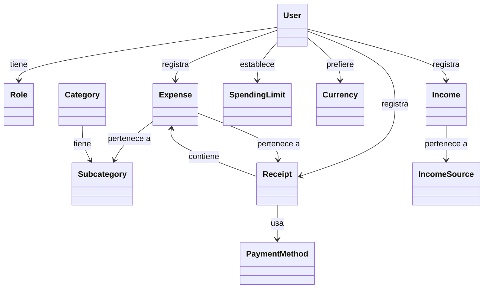
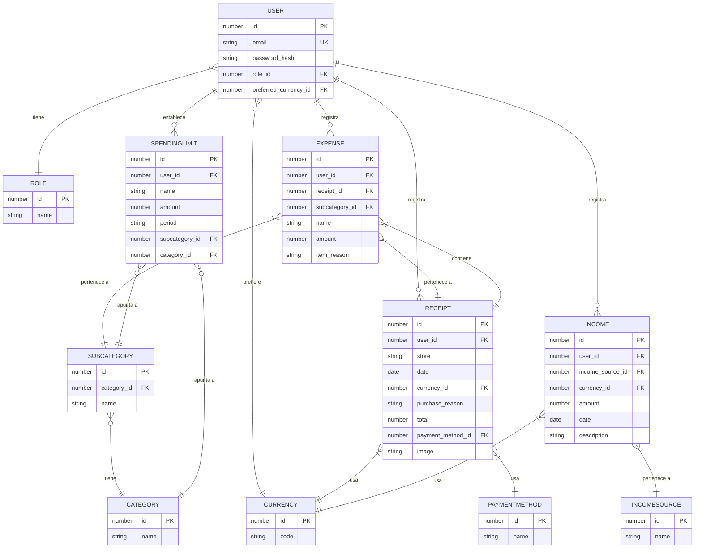

# Database Schema — Finance AI Tracker

> **Executable version:** [`docs/schema.sql`](./schema.sql) — complete PostgreSQL schema.
> Paste it into [dbdiagram.io](https://dbdiagram.io) (Import → PostgreSQL) for a clean rendered diagram.

## Stage 1 — Domain Level Diagram

Core entities and their relationships. No attributes or methods — just the business vocabulary.

## Stage 2 — Analysis Level

### ER Diagram (grows as entities get locked)

### User (✅ locked)

| Attribute | Type | Rules |
|-----------|------|-------|
| `id` | number | PK, auto-generated |
| `email` | string | unique, required |
| `password_hash` | string | hashed, required |
| `role_id` | FK → Role | required |
| `preferred_currency_id` | FK → Currency | optional — display preference only; falls back to "COP" |

### Role (✅ locked)

| Attribute | Type | Rules |
|-----------|------|-------|
| `id` | number | PK, auto-generated |
| `name` | string | required, unique — "user", "admin" |

### Category (✅ locked)

| Attribute | Type | Rules |
|-----------|------|-------|
| `id` | number | PK, auto-generated |
| `name` | string | required, unique — "Food", "Transport", "Entertainment" |

### Expense (✅ locked)

| Attribute | Type | Rules |
|-----------|------|-------|
| `id` | number | PK, auto-generated |
| `user_id` | FK → User | required |
| `receipt_id` | FK → Receipt | required |
| `subcategory_id` | FK → Subcategory | required ("No subcategory" default) |
| `name` | string | required — "Banana", "Subway sandwich" |
| `amount` | number | required |
| `item_reason` | string | optional — individual reason for this item |

### Income (✅ locked)

| Attribute | Type | Rules |
|-----------|------|-------|
| `id` | number | PK, auto-generated |
| `user_id` | FK → User | required |
| `income_source_id` | FK → IncomeSource | required |
| `currency_id` | FK → Currency | required |
| `amount` | number | required |
| `date` | date | required |
| `description` | string | optional — "first payment of the month" |

### IncomeSource (✅ locked)

| Attribute | Type | Rules |
|-----------|------|-------|
| `id` | number | PK, auto-generated |
| `name` | string | required, unique — "Work", "Freelance", "Gift" |

### Receipt (✅ locked)

| Attribute | Type | Rules |
|-----------|------|-------|
| `id` | number | PK, auto-generated |
| `user_id` | FK → User | required |
| `store` | string | required — place of buy |
| `date` | date | required |
| `currency_id` | FK → Currency | required |
| `purchase_reason` | string | optional — reason for the whole purchase |
| `total` | number | required — printed total from the receipt |
| `payment_method_id` | FK → PaymentMethod | required |
| `image` | string (path) | optional — null when no photo |

### PaymentMethod (✅ locked)

| Attribute | Type | Rules |
|-----------|------|-------|
| `id` | number | PK, auto-generated |
| `name` | string | required, unique — "Cash", "Card", "Transfer", "Nequi"... |

### Subcategory (✅ locked)

| Attribute | Type | Rules |
|-----------|------|-------|
| `id` | number | PK, auto-generated |
| `category_id` | FK → Category | required |
| `name` | string | required — "Groceries", "Eating out", "No subcategory" |

### Currency (✅ locked)

| Attribute | Type | Rules |
|-----------|------|-------|
| `id` | number | PK, auto-generated |
| `code` | string | required, unique — "USD", "COP", "EUR" |

### SpendingLimit (✅ locked)

| Attribute | Type | Rules |
|-----------|------|-------|
| `id` | number | PK, auto-generated |
| `user_id` | FK → User | required |
| `name` | string | required — label ("Food budget") |
| `amount` | number | required — in the user's preferred currency |
| `period` | string | required — "weekly" \| "monthly" |
| `subcategory_id` | FK → Subcategory | optional — set when the limit targets one subcategory |
| `category_id` | FK → Category | optional — set when the limit targets a whole category |

**Rule (XOR):** exactly one of `subcategory_id` / `category_id` must be set — never both, never neither. Enforced by the UI and a database constraint.

## Entities (11 total)

| Entity | Purpose |
|--------|---------|
| **User** | Registered users who track expenses |
| **Role** | User roles (user, admin) |
| **Expense** | Individual items or transactions |
| **Category** | Predefined main categories (Food, Transport, etc.) |
| **Subcategory** | AI-generated subcategories |
| **Receipt** | Purchase transaction metadata (store, date, total, image) |
| **SpendingLimit** | User-defined spending limits by category |
| **Currency** | Supported currencies (USD, COP, EUR, etc.) |
| **Income** | Registered income entries (salary, freelance...) |
| **IncomeSource** | Income sources list (Work, Freelance, Gift...) |
| **PaymentMethod** | Payment methods list (Cash, Card, Transfer, Nequi...) |

## Relationships

| From | To | Relationship | Description |
|------|-----|--------------|-------------|
| User | Role | tiene | User has one role |
| User | Expense | registra | User registers many expenses |
| User | Receipt | registra | User registers many receipts |
| User | Income | registra | User registers many incomes |
| User | SpendingLimit | establece | User sets many spending limits |
| User | Currency | prefiere | User has a preferred display currency |
| Expense | Subcategory | pertenece a | Expense belongs to one subcategory (required) |
| Category | Subcategory | tiene | Category has many subcategories |
| Receipt | Expense | contiene | Receipt contains many expenses |
| Expense | Receipt | pertenece a | Expense belongs to one receipt (required) |
| Receipt | Currency | usa | Receipt has one purchase currency |
| Receipt | PaymentMethod | usa | Receipt has one payment method |
| Income | IncomeSource | pertenece a | Income belongs to one income source |
| Income | Currency | usa | Income has one currency |
| SpendingLimit | Subcategory | apunta a | Limit targets one subcategory (XOR with category) |
| SpendingLimit | Category | apunta a | Limit targets a whole category (XOR with subcategory) |

## Notes

- **Receipt is required**: Every expense belongs to a receipt. Even simple expenses (e.g., "I spent $15 on lunch") create a minimal receipt (store = "Manual", image = null). The receipt belongs to a user directly (`user_id`) — this matches the index on `receipt.user_id`.
- **Ownership consistency**: `Expense.user_id` and `Receipt.user_id` must always reference the same user. Enforced by the application, not a DB constraint (checked during review).
- **Image is a file path**: `receipt.image` stores a path/URL (`TEXT`), not the binary itself — keeps the DB light; the image file lives on disk/object storage.
- **Total is stored**: `total` = the printed total from the receipt (the truth). It may differ from the sum of items (taxes, discounts, roundings). Items are detail; total is what the store charged.
- **Payment methods**: Separate entity (PaymentMethod — Cash, Card, Transfer, Nequi...) for scalability — adding a new method needs no code change.
- **Flexible model**: Handles both simple expenses ("spent $15 on lunch") and detailed receipts (individual items extracted by AI from photo)
- **Currency**: Master list of supported currencies. The Receipt stores the purchase currency (`currency_id` — one purchase = one currency). The User sets a preferred display currency (`preferred_currency_id`), stored on the User row; conversion happens on-the-fly for display only, never stored (if unset, the app falls back to COP). Original amount and original currency are always kept as the truth.
- **Category hierarchy**: Expense links to Subcategory (required, "No subcategory" default per category). Category is derived through the subcategory's parent. No direct category link on Expense.
- **Reason (hybrid approach)**: Receipt has `purchase_reason` (applies to the whole purchase, e.g., "weekly groceries"). Expense has `item_reason` (optional, specific to that item, e.g., "it was on discount"). If `item_reason` is null, the expense inherits `purchase_reason` from the receipt.
- **Income**: Registered separately from expenses, with its own source list (IncomeSource — Work, Freelance, Gift...). Optional `description` instead of a reason. Currency follows the same rule as receipts (store original, convert on display). Enables balance analysis ("am I spending more than I earn?").
- **SpendingLimit target (XOR rule)**: A limit is one rule with one target. Both `subcategory_id` and `category_id` set would make it ambiguous (e.g., Food + Eating out could mean "all Food", "Eating out only", or double-count Eating out) — so the UI prevents it and the database enforces exactly one via a CHECK constraint.
- **SpendingLimit currency**: Limit amounts are in the user's preferred currency — a limit is a personal target, not a purchase, so no per-limit currency.
- **SpendingLimit**: Phase 3 feature, included in domain design for completeness

## Indexes

Indexes are the database's "quick-reference sheets": a sorted copy of a column so lookups jump straight to matching rows instead of reading the whole table.

| Entity | Indexed columns | Why |
|--------|-----------------|-----|
| User | `email` (automatic via unique) | Enforcing the unique rule creates the index automatically |
| Expense | `user_id`, `receipt_id`, `subcategory_id` | "my expenses", "this receipt's items", analytics by subcategory |
| Receipt | `user_id`, `date`, `payment_method_id` | "my receipts", "spending this month", "how much paid with card" |
| Income | `user_id`, `date`, `income_source_id` | "my income", monthly balance, "how much from Freelance" |
| SpendingLimit | `user_id` | "load my limits" |
