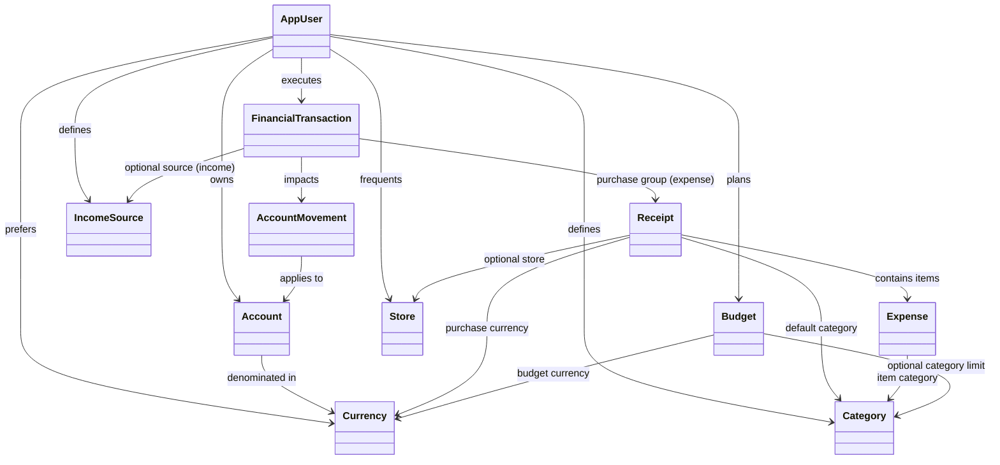
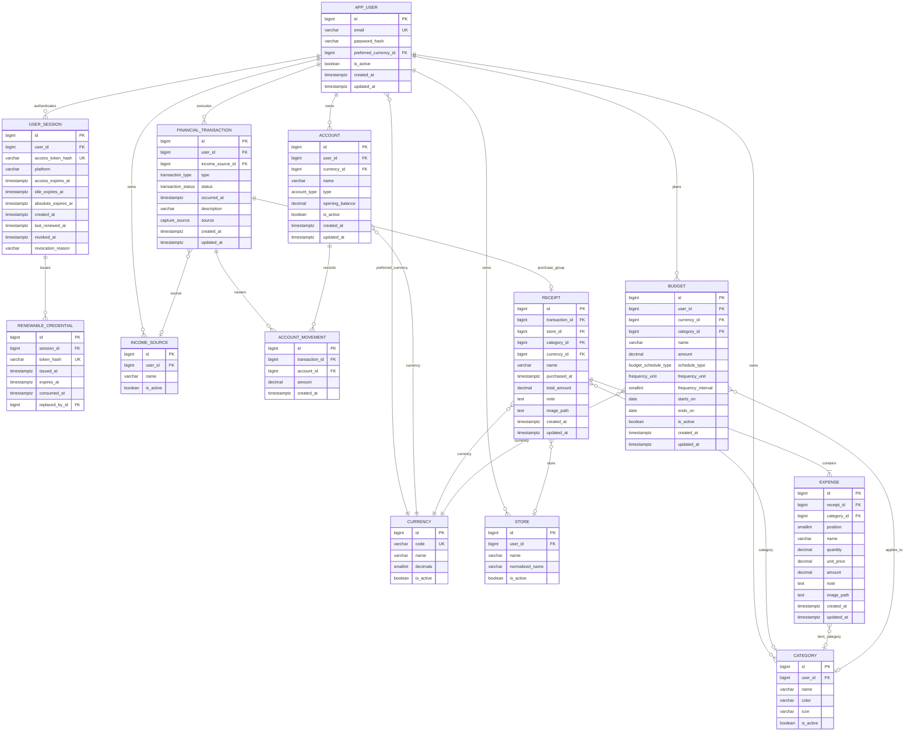

# Database Schema — Finance AI Tracker

> **Design snapshot:**
> - **DBML (dbdiagram.io):** [`docs/schema.dbml`](./schema.dbml) — original editable design.
> - **PostgreSQL DDL:** [`docs/schema.sql`](./schema.sql) — original executable design schema.
> - **Implemented schema authority:** backend Alembic migrations and SQLAlchemy models. The
>   diagrams and table descriptions below have not been reconciled table by table with those
>   sources; use them as design history, not as an inventory of the deployed database.

---

## 1. Domain Overview & Entity Groups

The database is divided into four logical table groups:

1. **Identity & Reference**: User authentication, long-lived sessions, renewable credentials, and reference currencies.
2. **Accounts & Movements (Ledger Pattern)**: Immutable event ledger tracking financial transactions and signed account movements (no mutable balances).
3. **Receipts & Expenses (Purchase Groups)**: Grouping expenses under receipts with optional store, category, and evidence attachments.
4. **Classification & Planning**: User-defined categories and recurring/one-time budgets.

---

## 2. Entity Relationship Diagram (ERD)

---

## 3. Core Architectural Principles

### 1. The Ledger Engine (Movements over Mutable Balances)
* The database **never stores a mutable balance column** like `account.balance = 500`.
* Every balance-affecting event creates a parent [`financial_transaction`](file:///home/d3ad/codigos/finance-ai/docs/schema.sql#L125-L147) and one or more [`account_movement`](file:///home/d3ad/codigos/finance-ai/docs/schema.sql#L154-L163) rows.
* Movements carry a **signed amount** in the account's currency:
  * **Expenses**: strictly negative (`amount < 0`).
  * **Income**: strictly positive (`amount > 0`).
  * **Transfers**: one negative movement on the source account, one positive movement on the destination account.
* Account live balance is computed dynamically:
  $$\text{Live Balance} = \text{opening\_balance} + \sum(\text{account\_movement.amount})$$

### 2. Hard Multi-Tenant Isolation
* All tenant resources (`account`, `category`, `store`, `income_source`, `financial_transaction`, `budget`) belong to `app_user` via `user_id`.
* Composite unique constraints ensure unique names per user:
  * `(user_id, name)` on `account`, `category`, `income_source`.
  * `(user_id, normalized_name)` on `store`.
* Foreign key checks reject any cross-tenant data references at the database engine level.

### 3. Purchase Group Model (Receipt & Expense)
* When an expense transaction occurs:
  * A `receipt` record represents the purchase group (store, overall category, currency, total amount, receipt note, receipt image).
  * One or more `expense` rows represent line items under that receipt (`name`, `quantity`, `unit_price`, `amount`, item note, item image).
* For simple or manual capture (HU-006), the receipt and a single expense line item are created automatically from the merchant name and total amount.
* Category is nullable on both `receipt` and `expense` — null represents **Uncategorized**.

### 4. Flexible Budget Scheduling
* Budgets can be **recurring** (`frequency_unit` and `frequency_interval` required, e.g., every 1 month or every 2 weeks).
* Budgets can be **one-time** (`schedule_type = 'one_time'`, frequency fields are null, `starts_on` and optional `ends_on` define custom range).
* A null `category_id` signifies an overall global spending budget.

---

## 4. Table Specifications

### Identity & Reference

#### `currency`
Master list of ISO currency codes supported by the system.
| Column | Type | Constraints | Description |
|---|---|---|---|
| `id` | `bigint` | PK, auto-increment | Primary key |
| `code` | `varchar(10)` | NOT NULL, UNIQUE | ISO currency code (e.g. `COP`, `USD`, `EUR`) |
| `name` | `varchar(100)` | NOT NULL | Currency name (e.g. `Peso colombiano`) |
| `decimals` | `smallint` | NOT NULL, DEFAULT 2 | Decimal places |
| `is_active` | `boolean` | NOT NULL, DEFAULT true | Active status |

#### `app_user`
Registered users.
| Column | Type | Constraints | Description |
|---|---|---|---|
| `id` | `bigint` | PK, auto-increment | Primary key |
| `email` | `varchar(320)` | NOT NULL, UNIQUE | User email address |
| `password_hash` | `varchar(255)` | NOT NULL | Hashed password |
| `preferred_currency_id` | `bigint` | NOT NULL, FK → `currency.id` (RESTRICT) | Preferred display currency |
| `is_active` | `boolean` | NOT NULL, DEFAULT true | Account status |
| `created_at` | `timestamptz` | NOT NULL, DEFAULT `now()` | Registration timestamp |
| `updated_at` | `timestamptz` | NOT NULL, DEFAULT `now()` | Last updated timestamp |

#### `user_session` & `renewable_credential`
Token-based session authentication with refresh/rotation capabilities.

---

### Accounts & Movements (Ledger Engine)

#### `account`
Financial accounts (cash, bank, digital wallet, credit card, etc.).
| Column | Type | Constraints | Description |
|---|---|---|---|
| `id` | `bigint` | PK, auto-increment | Primary key |
| `user_id` | `bigint` | NOT NULL, FK → `app_user.id` (CASCADE) | Account owner |
| `currency_id` | `bigint` | NOT NULL, FK → `currency.id` (RESTRICT) | Denominated currency |
| `name` | `varchar(100)` | NOT NULL | Account name (`Cash`, `Nequi`, `Bancolombia`) |
| `type` | `account_type` | NOT NULL (enum) | `cash`, `bank`, `digital_wallet`, `savings`, `credit_card`, `other` |
| `opening_balance` | `numeric(18,2)` | NOT NULL, DEFAULT 0 | Initial balance |
| `is_active` | `boolean` | NOT NULL, DEFAULT true | Active flag |
| `created_at` / `updated_at` | `timestamptz` | NOT NULL, DEFAULT `now()` | Audit timestamps |

*Constraints:* UNIQUE `(user_id, name)`. Index on `(user_id, is_active)`.

#### `financial_transaction`
Parent event record for every financial action.
| Column | Type | Constraints | Description |
|---|---|---|---|
| `id` | `bigint` | PK, auto-increment | Primary key |
| `user_id` | `bigint` | NOT NULL, FK → `app_user.id` (CASCADE) | Transaction owner |
| `income_source_id` | `bigint` | NULLABLE, FK → `income_source.id` (SET NULL) | Linked source (income only) |
| `type` | `transaction_type` | NOT NULL (enum) | `expense`, `income`, `transfer`, `adjustment` |
| `status` | `transaction_status` | NOT NULL, DEFAULT `'confirmed'` | `confirmed`, `pending`, `voided` |
| `occurred_at` | `timestamptz` | NOT NULL | Occurrence timestamp |
| `description` | `varchar(250)` | NULLABLE | Transaction concept / description |
| `source` | `capture_source` | NOT NULL, DEFAULT `'manual'` | `manual`, `text_ai`, `audio_ai`, `receipt_photo_ai`, `import` |
| `created_at` / `updated_at` | `timestamptz` | NOT NULL, DEFAULT `now()` | Audit timestamps |

*Check:* `type = 'income' OR income_source_id IS NULL`.

#### `account_movement`
Signed ledger deltas affecting account balances.
| Column | Type | Constraints | Description |
|---|---|---|---|
| `id` | `bigint` | PK, auto-increment | Primary key |
| `transaction_id` | `bigint` | NOT NULL, FK → `financial_transaction.id` (CASCADE) | Parent transaction |
| `account_id` | `bigint` | NOT NULL, FK → `account.id` (RESTRICT) | Impacted account |
| `amount` | `numeric(18,2)` | NOT NULL, CHECK (`amount <> 0`) | Signed amount (negative = expense, positive = income) |
| `created_at` | `timestamptz` | NOT NULL, DEFAULT `now()` | Creation timestamp |

---

### Receipts & Expenses

#### `receipt`
Purchase group for expense transactions.
| Column | Type | Constraints | Description |
|---|---|---|---|
| `id` | `bigint` | PK, auto-increment | Primary key |
| `transaction_id` | `bigint` | NOT NULL, UNIQUE, FK → `financial_transaction.id` (CASCADE) | Linked 1:1 to parent transaction |
| `store_id` | `bigint` | NULLABLE, FK → `store.id` (SET NULL) | Store / merchant |
| `category_id` | `bigint` | NULLABLE, FK → `category.id` (SET NULL) | Default category for the purchase |
| `currency_id` | `bigint` | NOT NULL, FK → `currency.id` (RESTRICT) | Purchase currency |
| `name` | `varchar(200)` | NOT NULL | Purchase group display name |
| `purchased_at` | `timestamptz` | NOT NULL | Purchase date/time |
| `total_amount` | `numeric(18,2)` | NOT NULL, CHECK (`total_amount > 0`) | Total receipt amount |
| `note` | `text` | NULLABLE | Purchase note / memo |
| `image_path` | `text` | NULLABLE | Path/URL to receipt photo (stored outside DB) |
| `created_at` / `updated_at` | `timestamptz` | NOT NULL, DEFAULT `now()` | Audit timestamps |

#### `expense`
Individual item rows under a receipt.
| Column | Type | Constraints | Description |
|---|---|---|---|
| `id` | `bigint` | PK, auto-increment | Primary key |
| `receipt_id` | `bigint` | NOT NULL, FK → `receipt.id` (CASCADE) | Parent receipt |
| `category_id` | `bigint` | NULLABLE, FK → `category.id` (SET NULL) | Item category (null = Uncategorized) |
| `position` | `smallint` | NOT NULL, DEFAULT 1 | Item position/ordering in receipt |
| `name` | `varchar(200)` | NOT NULL | Item name |
| `quantity` | `numeric(12,3)` | NOT NULL, DEFAULT 1, CHECK (`quantity > 0`) | Item quantity |
| `unit_price` | `numeric(18,2)` | NULLABLE, CHECK (`unit_price >= 0`) | Price per unit |
| `amount` | `numeric(18,2)` | NOT NULL, CHECK (`amount >= 0`) | Total item amount |
| `note` | `text` | NULLABLE | Item-specific memo |
| `image_path` | `text` | NULLABLE | Optional item-level photo path |
| `created_at` / `updated_at` | `timestamptz` | NOT NULL, DEFAULT `now()` | Audit timestamps |

*Constraints:* UNIQUE `(receipt_id, position)`.

---

### Planning & Classification

#### `category`
User-defined transaction categories.
* Columns: `id`, `user_id`, `name`, `color`, `icon`, `is_active`.
* Constraint: UNIQUE `(user_id, name)`.

#### `store`
Stores and vendors with name normalization for analytics.
* Columns: `id`, `user_id`, `name`, `normalized_name`, `is_active`.
* Constraint: UNIQUE `(user_id, normalized_name)`.

#### `budget`
Category or overall spending limits.
* Columns: `id`, `user_id`, `currency_id`, `category_id` (optional), `name`, `amount`, `schedule_type` (`recurring` / `one_time`), `frequency_unit`, `frequency_interval`, `starts_on`, `ends_on`, `is_active`, timestamps.
* Constraints: Check constraints ensure positive amount, valid date ranges, and proper configuration of recurring vs one-time parameters.
