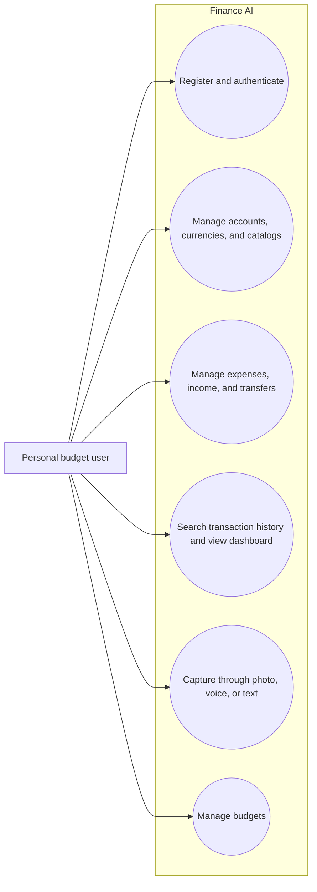
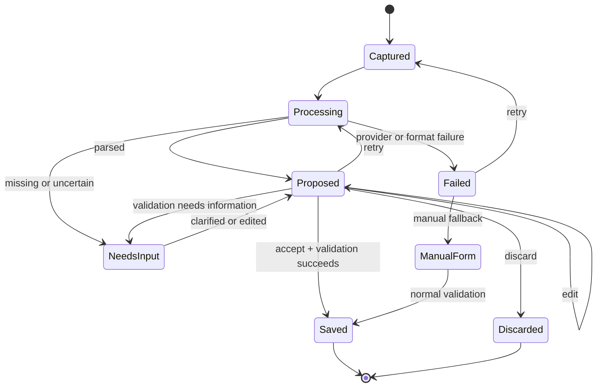
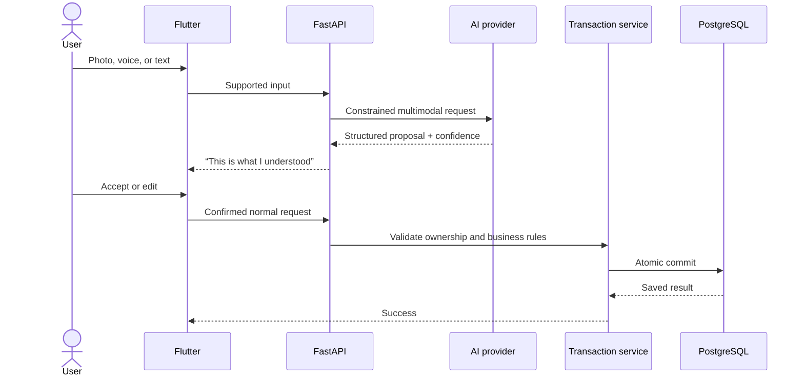

# UML Views — Finance AI

This file contains only the current high-level product views. Detailed data relationships live in `SCHEMA.md`; deployment and module boundaries live in `ARCHITECTURE.md`.

## Use Cases

## AI Proposal State

## Transaction Sequence

