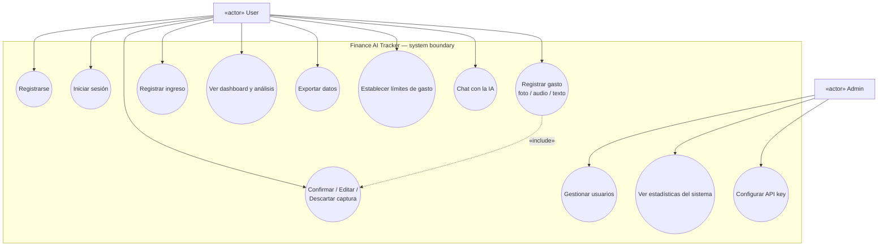
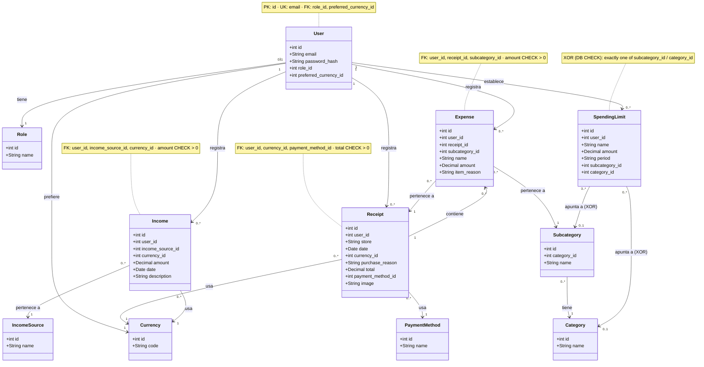
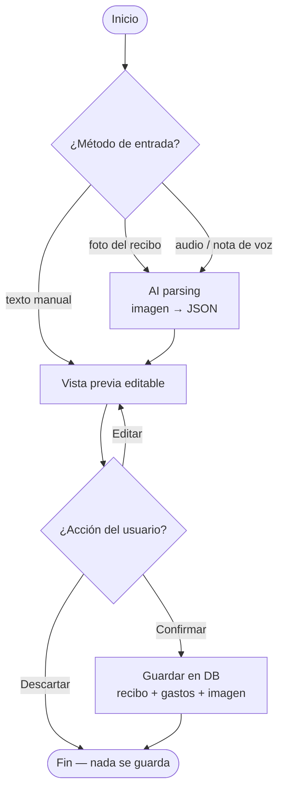
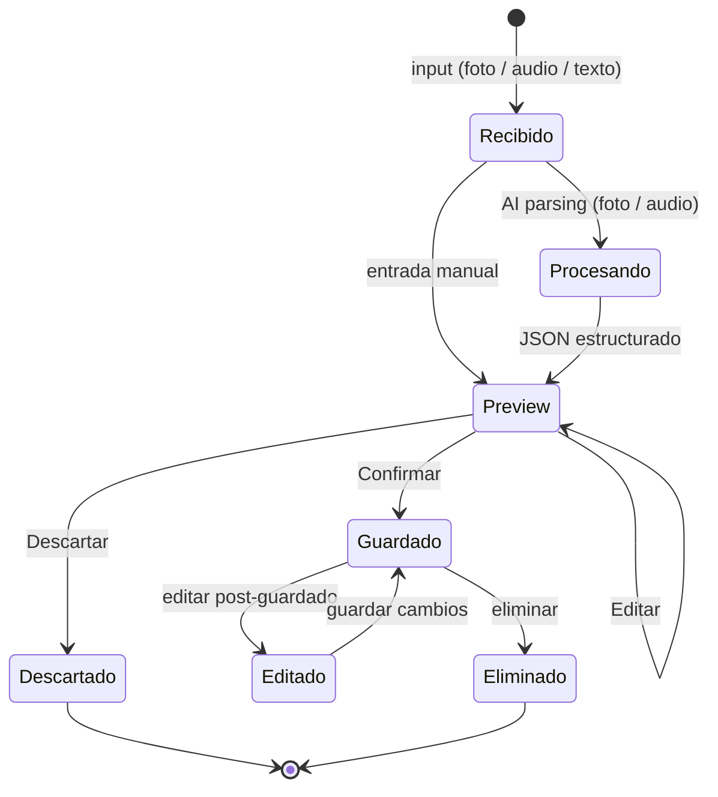
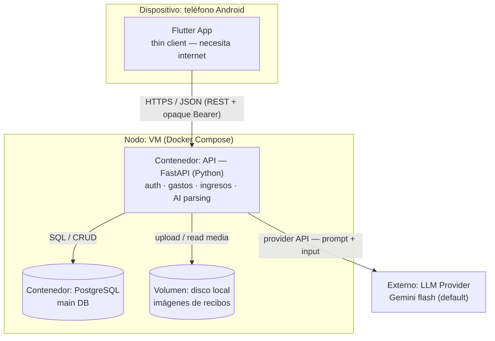
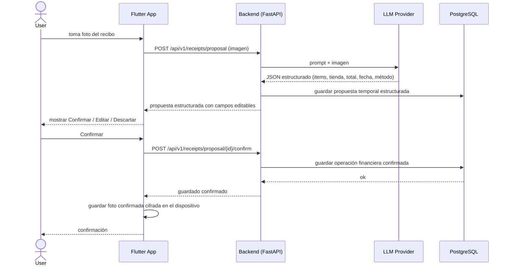
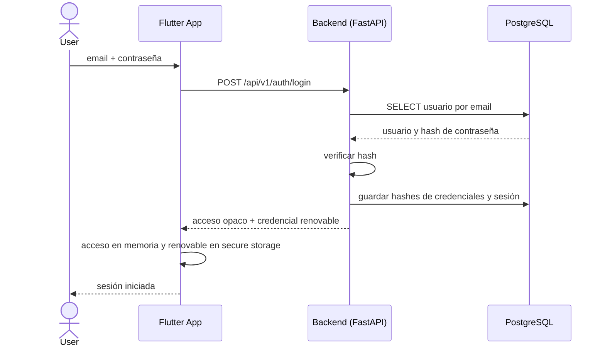
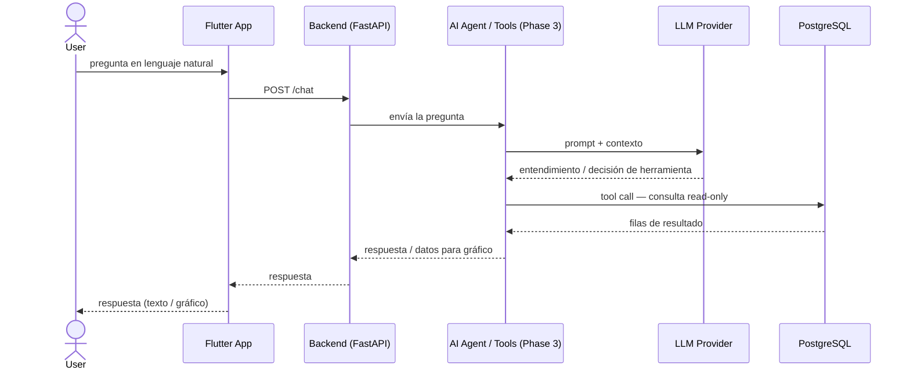

# UML Diagrams — Finance AI Tracker

> **Status:** GENERATED — auto-inferred from existing repository data (2026-08-25).
> **Sources:** `docs/schema.sql` · `docs/SCHEMA.md` · `docs/ARCHITECTURE.md` · `docs/ALCANCE.md` ·
> `docs/FEATURES.md` · `docs/BACKLOG-AND-STORIES.md` · `docs/STACK.md` · `docs/step5-plan.md`.
> **Historical design snapshot:** these diagrams were generated from documents on 2026-08-25,
> before the current frontend/backend implementation. They are not the source for the PGC component
> diagram. The existing editable component source is the locally untracked
> `docs/diagrams/architecture-components.puml` (see `docs/diagrams/README.md` for its evidence
> and validation limits). Mermaid flowcharts,
> the DFDs in `ARCHITECTURE.md`, and the ERD in `SCHEMA.md` are not formal UML component diagrams.
> **Original validation:** the 2026-08-25 diagrams were rendered with `mmdc` 11.16.0 and Chrome.
> The revised sequences below require separate render validation before academic submission.
> **Roles caveat:** Admin appears here per `docs/ALCANCE.md` ("Roles & Permissions"). Note that
> `docs/step5-plan.md` Q1 deliberately **excludes Admin from the architecture diagrams** (project
> decision) — the use case diagram below keeps both actors until that decision is revisited.

## Inventory (text alternative)

| # | Diagram | Shows | Source data |
|---|---------|-------|-------------|
| 1 | Use Case | 2 actors (User, Admin) + 12 use cases, Phase 2/3 marked | ALCANCE roles · FEATURES phases · backlog |
| 2 | Class (historical data model) | 11 classes from the original design, not the Alembic schema | schema.sql |
| 3 | Activity | Expense capture: input → AI parsing → preview → Confirm/Edit/Discard | ALCANCE processing flow · DFD 1 |
| 4 | State machine | Expense lifecycle: received → parsing → preview → saved / discarded → edited / deleted | ALCANCE pre/post-save |
| 5 | Deployment (historical VM proposal) | Android phone ↔ VM (API + PostgreSQL + local disk) + external LLM | STACK.md · step5 Q2–Q3 |
| 6 | Sequence ×3 | (a) receipt proposal and confirmation, (b) renewable session login, (c) proposed Phase 3 AI chat | Implemented API · historical Phase 3 proposal |

> The ER diagram already lives in `docs/SCHEMA.md` (Mermaid `erDiagram`) — not duplicated here.
> Re-render it anytime by importing `docs/schema.sql` into dbdiagram.io (Import → PostgreSQL).

---

## 1. Use Case Diagram

Legend: ellipses = use cases · rectangles = actors · UC8 = Phase 2 · UC9 = Phase 3 (optional) ·
UC10–UC12 = Admin only (per `ALCANCE.md`, Admin does not view individual user data).

## 2. Class Diagram (historical data model, from schema.sql)

The effective database structure must be checked against backend SQLAlchemy models and Alembic
migrations. This diagram preserves the earlier `schema.sql` design and should not be used as a
current table inventory.

## 3. Activity Diagram — capture an expense

## 4. State Machine — expense lifecycle

## 5. Deployment Diagram (historical VM proposal from STACK.md)

This diagram retains the original VM and server-file-storage design. In the implemented flow,
confirmed receipt photos are cached encrypted on the device, local development uses Compose with
PostgreSQL, and the backend repository has a separate Cloud Run deployment workflow. Do not use
this older diagram to claim the current production topology.

## 6. Sequence Diagrams

### 6a — Receipt photo proposal and confirmation (implemented API)

### 6b — Login with renewable opaque session (implemented API)

### 6c — Ask the AI (OPTIONAL Phase 3)

---

## Notes

- **Original generation:** these diagrams were derived from repository documents in 2026-08-25.
  The historical class diagram mirrors the earlier `docs/schema.sql`; the use cases mirror
  `ALCANCE.md` roles + `FEATURES.md` phases; the flows mirror `ALCANCE.md` + the DFDs in
  `docs/ARCHITECTURE.md`.
- **Current code exists:** backend `openapi.json`, routers, models and migrations provide the
  implementation evidence. `docs/CONTEXT.md` records the pre-code planning period, not current
  workspace status. The PGC component source and evidence are under `docs/diagrams/`.
- **ER diagram:** already present in `docs/SCHEMA.md` — regenerate via dbdiagram.io with
  `docs/schema.sql`.
- **Render:** paste any block into mermaid.live, or preview in Zed / GitHub (flowchart-based
  diagrams render everywhere; see `docs/guides/architecture-diagrams-guide.md` §6 for the C4 gotcha).
