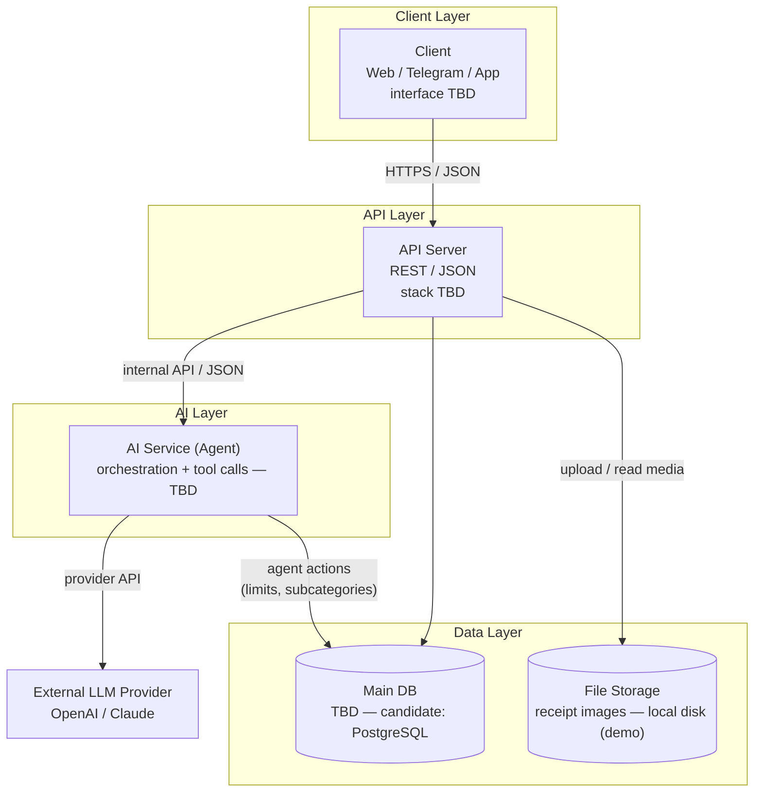
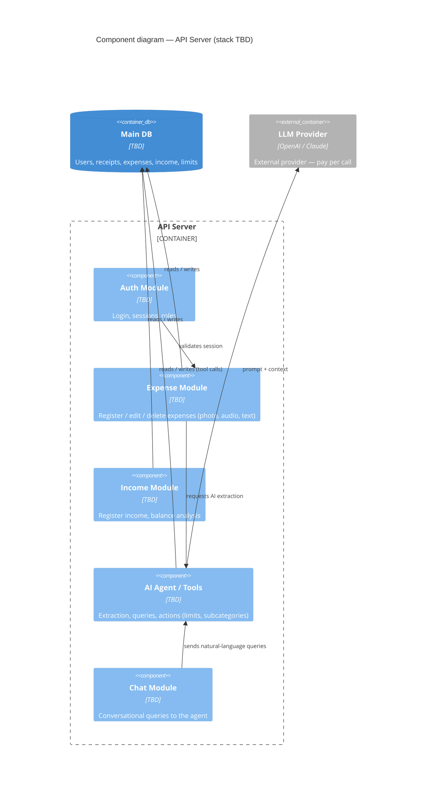
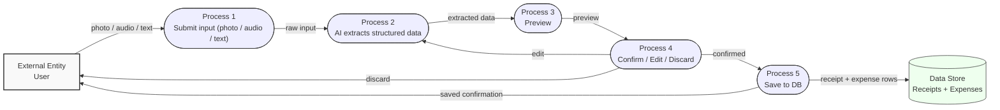
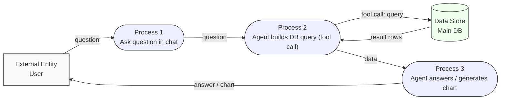
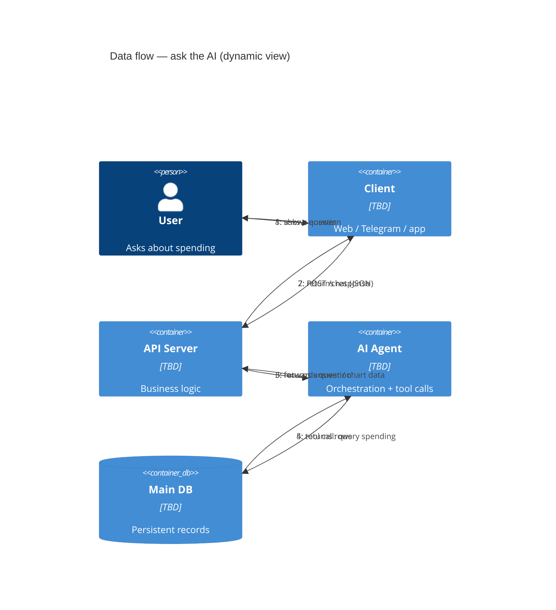

# Architecture Diagrams Guide — Step 5

> How to draw the three architecture diagrams (layer, component, data flow) in Mermaid,
> when the technology stack is **not defined yet**.
> Time budget: 1 day. Output: 3 Mermaid files, versioned in the repo.
> Historical reference status: the examples in sections 5–7 predate the manual-first decision and are not current Finance AI requirements. Use `docs/ARCHITECTURE.md` and `docs/step5-plan.md` as the approved project diagrams.

---

## 1. What to define BEFORE drawing (30–60 min)

Answer these on paper first. The diagrams only render decisions you already made.

| # | Question | Output |
|---|---|---|
| 1 | Who uses the system? | List of actors (student, admin, provider…) |
| 2 | What is inside the system vs outside? | System boundary |
| 3 | What are the top-level deployable units? | Container list (Client, API, AI, DB, cache…) |
| 4 | What modules does each unit contain? | Module list per container |
| 5 | What data does the system store? | Data-store list (main DB, cache, vector DB…) |
| 6 | What are the 2–3 end-to-end journeys? | Journey descriptions (e.g. "enrollment") |
| 7 | Which decisions are still open? | TBD list (this is a feature, not a bug) |

Rule: **labels carry responsibilities, not technologies**. "Serves the web UI" not "React".
Technologies go in a `TBD — candidates: …` note when undecided.

---

## 2. Methodology

- **C4 model** (Simon Brown): 4 zoom levels — Context, Containers, Components, Code.
  - Layer diagram (Client → API → AI → DB) = **Container diagram** (level 2).
  - Component diagram (modules) = **Component diagram** (level 3).
  - Sources: https://c4model.com/ · https://icepanel.io/blog/2025-08-28-top-9-tools-for-c4-model-diagrams
- **DFD** (Yourdon / Gane-Sarson) for the data-flow diagram: external entities → processes → data stores → labeled flows.
  - Source: https://www.geeksforgeeks.org/system-design/how-to-draw-architecture-diagrams/
- **AI pattern decision** (from Google Cloud Architecture Center): decide single-agent vs multi-agent vs plain RAG before drawing the AI layer; start with a single agent if unsure. Requirements to weigh: task complexity, latency, cost, human-in-the-loop.
  - Source: https://docs.cloud.google.com/architecture/choose-design-pattern-agentic-ai-system

---

## 3. Mermaid: what works and what doesn't (checked against official docs, Mermaid 11.x)

| Capability | Status | Notes |
|---|---|---|
| `flowchart` for layer/DFD diagrams | ✅ Stable | 30 extra shapes since v11.3.0 (docs: mermaid.js.org/syntax/flowchart.html) |
| `C4Context` / `C4Container` / `C4Component` / `C4Dynamic` / `C4Deployment` | ⚠️ Experimental | Syntax compatible with C4-PlantUML; layout = statement order; fixed styles; **no legend/tags/sprite support yet** (docs: mermaid.js.org/syntax/c4.html) |
| Native DFD diagram type | ❌ Does not exist | Use `flowchart` with conventional shapes + a legend (see §7) |
| Rendering | ✅ | mermaid.live editor, GitHub preview, Zed built-in renderer, `mmdc` CLI for SVG/PNG export |

Flowchart pitfalls (official docs):
- The word `end` inside a node breaks rendering — capitalize it (`End`, `END`).
- Node ids starting with `o` or `x` are parsed as circle/cross edges — add a space or capitalize.
- Label arrows with `|"label"|`; use quotes when the label contains `/`, `(`, `)`.

---

## 4. AI-layer guidance (draw this correctly)

Represent AI honestly — it is never a magic box:

| Element | C4 element | Example |
|---|---|---|
| Model provider (OpenAI, Claude/Anthropic) | `System_Ext` / `Container_Ext` | Outside your boundary; you pay per call |
| Your AI service (orchestration, prompts, tools) | `Container` | Inside your boundary |
| Vector database (RAG) | `ContainerDb` | Only if you do retrieval |
| Prompt/context data | `Rel` labels | Label the flow "prompt + context" |
| Tool calls / function calls | `Rel` labels | Label the flow "tool call" if the agent invokes your API |

Key questions that change the diagram:
1. Does the AI layer call the model directly (non-agentic), or does an agent decide steps and call tools? (Google Cloud: non-agentic is cheaper and fine for predictable tasks)
2. Does it need retrieval (vector DB) or is the context in the prompt?
3. What does the AI layer write back to the DB? Label that arrow explicitly.

**Current Finance AI decision:** no AI layer is required by the manual MVP. A later optional backend adapter may request structured form proposals from an external provider, but it does not write directly to the database or execute autonomous tools. No vector DB/RAG is planned.

---

## 5. Layer diagram — Mermaid (`flowchart TD`)

One subgraph per layer, `[( )]` cylinders for databases, labeled arrows, `TBD` where open.



Rules:
- Arrows only between layers that actually talk; label **the protocol or format**, not the business action.
- The external provider box is **outside** the layers — draw it to the side, not inside AI Layer.
- Add a one-line note under the diagram: "Technologies TBD — this diagram is the contract, not the implementation."
- Vector DB and cache are intentionally absent: no RAG (structured DB queried via tool calls) and no cache pre-semester.

---

## 6. Component diagram — Mermaid (`C4Component`)

Exact syntax from the official docs (alias, label, technology, description).



C4 cheat sheet (valid in Mermaid and C4-PlantUML):

| Element | Syntax |
|---|---|
| Person | `Person(alias, "Label", "descr")` — external: `Person_Ext(...)` |
| System | `System(alias, "Label", "descr")` — DB: `SystemDb(...)`, external: `System_Ext(...)` |
| Container | `Container(alias, "Label", "tech", "descr")` — DB: `ContainerDb(...)`, queue: `ContainerQueue(...)`, external: `Container_Ext(...)` |
| Component | `Component(alias, "Label", "tech", "descr")` — `ComponentDb(...)`, `ComponentQueue(...)` |
| Boundary | `System_Boundary(alias, "Label") { … }`, `Container_Boundary(alias, "Label") { … }` |
| Relationship | `Rel(from, to, "label", "tech")`, bidirectional: `BiRel(...)`, direction control: `Rel_U/Rel_D/Rel_L/Rel_R` |
| Layout tweaks | `UpdateLayoutConfig(?c4ShapeInRow, ?c4BoundaryInRow)`, `UpdateRelStyle(from, to, $textColor=…, $lineColor=…)` |

C4 caveats (official docs): layout follows the **order of statements** (no `direction` keyword);
no `legend` support yet; styles are fixed. Keep the diagram small (≤ 15 shapes) or it gets hard to read.

**Zed gotcha:** the Zed built-in mermaid preview (and some GitHub configs) don't enable the
experimental `C4C` diagrams, so `C4Component` blocks won't render there even though the syntax is
valid. **Use `flowchart` instead** for any component diagram that needs to preview in Zed /
GitHub (same info, subgraph for the container, plain boxes for components, labeled `-->` arrows).
You can still keep the C4 version if you want mermaid.live rendering, but only one diagram type
should live in the project doc to avoid duplication.

---

## 7. Data flow — Mermaid (DFD style with `flowchart`)

Mermaid has no native DFD type, so use flowchart with conventional shapes + a legend:
entity = rectangle, process = stadium `([ ])`, store = cylinder `[( )]`, flow = labeled arrow.

### DFD 1 — Register an expense (with the confirmation loop)



This is the ALCANCE.md signature flow — the **loop back to Process 2** on edit must be present, or reviewers miss it.

### DFD 2 — Ask the AI



Alternative: `C4Dynamic` if the team prefers C4 notation for the same journey (numbered interactions):



If you need *strict* DFD notation (Yourdon circles, Gane-Sarson symbols), draw.io has real DFD shape libraries: https://www.diagrams.net/blog/c4-modelling

---

## 8. The AI prompt to generate these (copy-paste)

Give this to any AI assistant (OpenCode, Claude Code, etc.) so it produces valid Mermaid:

```
You are drawing architecture diagrams for a system whose stack is NOT decided yet.
Use Mermaid only, with these rules:
1. Layer diagram → flowchart TD, one subgraph per layer, [( )] for databases,
   a labeled arrow |"protocol"| on EVERY edge, "TBD" in boxes where the technology is open.
2. Component diagram → C4Component. Use Container_Boundary, Component(alias, "Label", "TBD", "descr"),
   ContainerDb, Container_Ext, and Rel(from, to, "label") only.
3. Data flow → flowchart LR with stadium ([ ]) processes, [( )] stores, rectangle entities,
   and every flow labeled with the data that moves.
4. Represent the AI honestly: LLM provider as an external box, AI service as a container,
   vector DB only if RAG exists.
5. NEVER invent a stack, NEVER use unsupported Mermaid features (legend, tags, sprites),
   capitalize "END" if it appears in a node, and every arrow must have a label.
```

---

## 9. Validation checklist (end of the day)

- [ ] Every box has a label describing a responsibility (not a brand).
- [ ] Every arrow has a label (protocol or data name). No naked arrows.
- [ ] External entities (users, LLM provider) are outside the boundary.
- [ ] No bidirectional arrows unless the flow really goes both ways.
- [ ] A legend exists (C4: note the caveat that Mermaid C4 has no legend yet — add one as text under the diagram).
- [ ] TBD annotations list candidate technologies, so the diagram drives the stack decision.
- [ ] All three diagrams render with zero warnings (mermaid.live https://mermaid.live or the IDE mermaid viewer, e.g. Zed).
- [ ] File storage container present (receipt.image path → storage box).
- [ ] Confirmation loop preview → confirm / edit / discard present in the DFD.
- [ ] Files are committed to the repo — diagrams live in `docs/ARCHITECTURE.md` (PNG/SVG exports go in `docs/diagrams/`), not left on a laptop.

---

## 10. Sources

- Mermaid C4 (experimental) — https://mermaid.js.org/syntax/c4.html
- Mermaid flowchart (shapes, pitfalls, v11.3.0+) — https://mermaid.js.org/syntax/flowchart.html
- C4 model (official) — https://c4model.com/
- Top 9 tools for C4 diagrams (IcePanel, 2025) — https://icepanel.io/blog/2025-08-28-top-9-tools-for-c4-model-diagrams
- How to draw architecture diagrams (GeeksforGeeks) — https://www.geeksforgeeks.org/system-design/how-to-draw-architecture-diagrams/
- Agentic AI design patterns (Google Cloud, reviewed 2026) — https://docs.cloud.google.com/architecture/choose-design-pattern-agentic-ai-system
- C4-PlantUML syntax reference (Mermaid C4 is compatible) — https://github.com/plantuml-stdlib/C4-PlantUML
