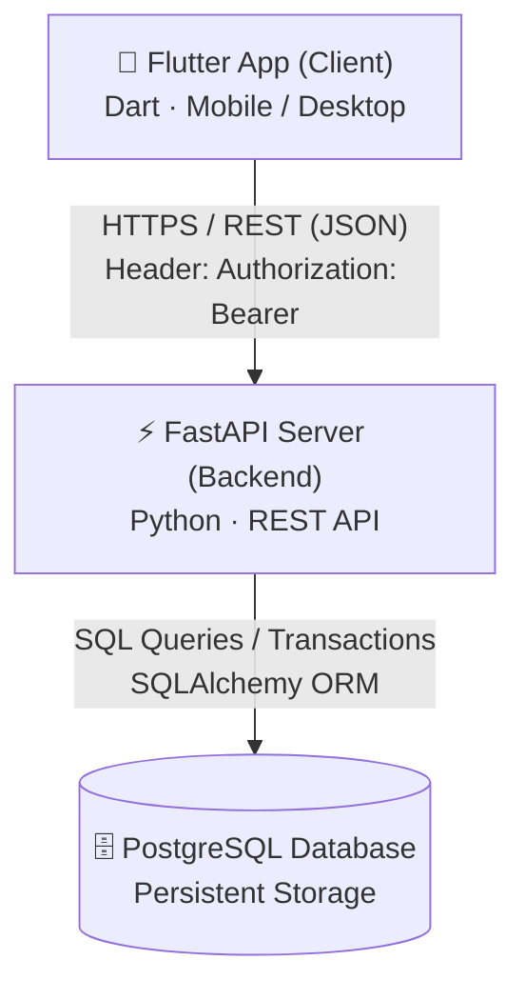
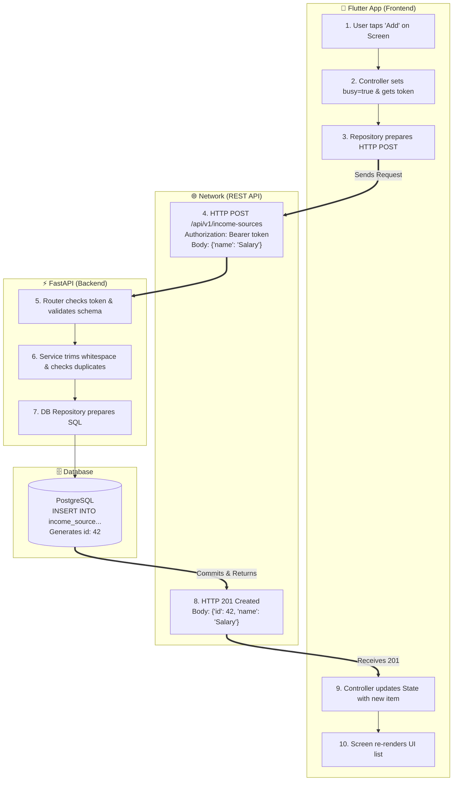

# Developer Notes: Architecture & Patterns

> **Status:** Work in progress (updated as we review each topic).

---

## 1. High-Level Mental Model

The app is divided into three major environments separated by network boundaries:



---

## 2. Frontend Roles (`finance-ai-frontend/lib/features/`)

* **Screen (`*_screen.dart`):**
  * **Role:** Pure UI and user interaction.
  * Draws the widgets, text fields, and lists.
  * Never touches the network or business logic. When clicked, it just tells the controller: `controller.add(name)`.

* **Controller (`*_controller.dart`):**
  * **Role:** State manager & coordinator (powered by Riverpod).
  * Manages UI state (toggles `busy = true` so the screen can show a loading indicator).
  * Reads the active user's authentication token from session state.
  * Calls the repository and refreshes the list upon success.
  * **Note:** The controller does *not* know any URLs.

* **Repository (`*_repository.dart`):**
  * **Role:** The network messenger.
  * **Holds the API URL path** (e.g. `static const _basePath = '/api/v1/income-sources'`).
  * Makes the actual HTTP request (`_apiClient.postJson(...)`) over the network to the backend API.

---

## 3. Backend Folders (`finance-ai-backend/src/finance_ai/`)

* **Router (`income_sources/router.py`):**
  * **Role:** The Front Desk for HTTP.
  * **Defines the REST route/URL** (e.g. `APIRouter(prefix="/income-sources")`).
  * Receives HTTP requests, extracts the user token, and delegates work to the service.
  * Contains **no business rules** and **no SQL**.

* **Service (`income_sources/service.py`):**
  * **Role:** The Business Rules (The Brain).
  * Validates data, trims whitespace, and checks for duplicates.
  * Knows *nothing* about URLs or HTTP.

* **Database Repositories (`db/repositories/`):**
  * **Role:** The SQL Worker.
  * Executes the actual database queries via SQLAlchemy (`INSERT`, `SELECT`, `UPDATE`).

---

## 4. The Complete Request Chain

### Swimlane Flowchart


### Detalle Paso a Paso (El Camino de Ida y Vuelta)

```text
[Flutter UI - Pantalla de Fuentes de Ingreso]
   │ 1. Usuario escribe "Freelance" y presiona "Guardar"
   ▼
[Frontend Controller] (income_sources_controller.dart)
   │ 2. Llama a: repository.create(name: "Freelance")
   ▼
[Frontend Repository] (income_sources_repository.dart)
   │ 3. Hace HTTP POST /api/v1/income-sources con el Bearer Token
   ══════════════════════════════════════════════════════════════════ (Internet / Red)
[Backend Router] (router.py)
   │ 4. Verifica el Token (saca user_id) y valida el JSON de entrada
   │ 5. Llama a: service.create(user_id=user_id, name=payload.name)
   ▼
[Backend Service - EL TRABAJADOR] (service.py)
   │ 6. Valida reglas de negocio: "¿Ya existe el nombre para este user?"
   │ 7. Abre el uow y llama a: uow.income_sources.add(...)
   ▼
[Backend UoW y BD] (repositories/income_sources.py y PostgreSQL)
   │ 8. Ejecuta el INSERT SQL
   │ 9. uow.commit() -> Se guarda en disco
   │ 10. PostgreSQL le devuelve el ID generado (ej: id: 5)
   │
   ├─► ¡EMPIEZA EL CAMINO DE REGRESO! ◄───────────────────────────────
   │
   │ 11. La BD le devuelve la fila al Service como IncomeSourceRecord(id: 5, name: "Freelance")
   ▼
[Backend Router]
   │ 12. El Service le devuelve el record al Router
   │ 13. El Router lo convierte a JSON: {"id": 5, "name": "Freelance"} y envía HTTP 201 Created
   ══════════════════════════════════════════════════════════════════ (Internet / Red)
[Frontend Repository]
   │ 14. Recibe el JSON y crea el modelo Dart: IncomeSource(id: 5, name: "Freelance")
   ▼
[Frontend Controller]
   │ 15. Actualiza el estado (State): agrega el nuevo IncomeSource a la lista
   ▼
[Flutter UI]
   │ 16. ¡La pantalla se redibuja automáticamente mostrando el nuevo ítem! 🎉
```

---

## 5. HTTP Responses & Execution Timeline

* **Where does `response.statusCode` come from?**
  * It comes 100% from the backend over the HTTP response packet (`HTTP/1.1 201 Created`).
* **Why `@router.post("", status_code=201)` is a conditional promise:**
  * It does *not* mean the backend returns 201 immediately before running the code.
  * It tells FastAPI: *"**IF** the function runs completely without errors, return 201."*
* **What happens if it fails to save (e.g. duplicate name)?**
  1. `service.py` raises an exception (`IncomeSourceNameTakenError`).
  2. The function **stops immediately** and never returns.
  3. The database transaction is rolled back (nothing saved).
  4. FastAPI intercepts the exception and returns **`409 Conflict`** (or `422` / `500`).
  5. The Flutter frontend catches that status code and displays an error message to the user.

---

## 6. Authentication & Session Security

### A. Why Tokens Cannot Be Forged (Cryptographic Signature)
* The token contains data (like `user_id = 7`) and a **mathematical signature**.
* The signature is created using a **Secret Key** that lives strictly inside the backend server (`.env`).
* If an attacker modifies the token (e.g. changing `user_id: 7` to `user_id: 1`), the mathematical signature breaks. FastAPI rejects it immediately with **`401 Unauthorized`**.

### B. How Sessions Persist Across App Restarts (The Two-Token System)
* **`access_credential` (Short-lived, 15–30 min):**
  * Kept in **RAM** (Riverpod state). Wiped when the app is closed.
* **`renewable_credential` / Refresh Token (Long-lived, days/weeks):**
  * Saved in **`FlutterSecureStorage`** (Apple Keychain on iOS / Keystore on Android / Credential Manager on Windows).
  * When the app reopens with empty RAM, Flutter reads the renewable credential from the hardware vault and calls `POST /api/v1/auth/refresh` to get a fresh `access_credential` automatically.

### C. Defense Against Session Hijacking (Token Theft)
Even if tokens work like keys, stealing them is prevented through 4 layers of defense:
1. **HTTPS (TLS Encryption):** All network headers and tokens are encrypted in transit; Wi-Fi eavesdroppers cannot read them.
2. **OS Sandboxing:** Mobile operating systems prevent other installed apps from accessing your app's secure storage.
3. **Short Expiration:** The active access token expires in minutes.
4. **Database Revocation Kill-Switch:** Sessions are tracked in PostgreSQL (`user_session` table). When a user clicks **Log Out**, the backend updates `revoked_at = NOW()`, instantly killing that session in the database so any copied token is permanently rejected.

---

## 7. The 20% Architecture Guide: Questions, Answers & Mental Model

### Topic 1: The Ledger Pattern (Why Two Tables?)
* **The Question:**  
  * *"So we use two tables to represent one transaction? `FinancialTransaction` is like the expense and `AccountMovement` is the movement that changes things in an account? What will `AccountMovement.amount` be?"*
* **How It Actually Works & How You Understood It:**  
  * The project **never** stores a mutable balance column (like `account.balance = account.balance - 50`).
  * `FinancialTransaction` represents the **story / event** (e.g. `transaction_type = 'expense'`).
  * `AccountMovement` represents the **cash delta**. For an expense, the amount is **negative** (`-20.00`) because it subtracts money from the account.
  * Live balance is always calculated dynamically:
    $$\text{Balance} = \text{opening\_balance} + \sum(\text{account\_movement.amount})$$
  * Separating them allows a single event to move money across multiple accounts (e.g. transfers, split expenses).
* **Code Reference:** [`src/finance_ai/db/models/transactions.py`](file:///home/d3ad/codigos/finance-ai/finance-ai-backend/src/finance_ai/db/models/transactions.py#L22-L80)

---

### Topic 2: Composite Foreign Keys & Multi-Tenant Isolation
* **The Question:**  
  * *"I see 4 IDs in `ForeignKeyConstraint(["account_id", "user_id"], ["account.id", "account.user_id"])`. What is the composite key? Where is it defined on the other table?"*
* **How It Actually Works & How You Understood It:**  
  * A composite key is a key made of **two or more columns paired together**.
  * Look at the 4 names:
    * `["account_id", "user_id"]` $\rightarrow$ The two columns in this table (`account_movement`).
    * `["account.id", "account.user_id"]` $\rightarrow$ The target columns in table `account` (prefixed with `account.`).
  * The target table must define a lock first: `UniqueConstraint("id", "user_id")` on `Account` and `FinancialTransaction`.
  * **The security win:** If User A tries to create an expense using User B's `account_id`, **PostgreSQL itself rejects the insert**. Multi-tenant security is enforced by the database engine, not by developer memory.
* **Code References:**  
  * Lock on Account: [`src/finance_ai/db/models/accounts.py#L35`](file:///home/d3ad/codigos/finance-ai/finance-ai-backend/src/finance_ai/db/models/accounts.py#L35)  
  * Key on Movement: [`src/finance_ai/db/models/transactions.py#L55-L66`](file:///home/d3ad/codigos/finance-ai/finance-ai-backend/src/finance_ai/db/models/transactions.py#L55-L66)

---

### Topic 3: Unit of Work (UoW), Sessions & Async Context Managers
* **The Question:**  
  * *"What is `async`? What does `if exc_type is not None:` mean? What are `__aenter__` and `__aexit__`? How long does the session stay active?"*
* **How It Actually Works & How You Understood It:**  
  * `async` / `await` allows non-blocking I/O so Python can serve other users while waiting for PostgreSQL.
  * When you write `async with uow:`, Python automatically runs `__aenter__()` (opens a fresh DB session and readies repositories).
  * When that code block ends or crashes, Python automatically runs `__aexit__()`.
  * `if exc_type is not None:` means: *"Did an error happen inside the block?"* If YES $\rightarrow$ it automatically calls `await self.rollback()`.
  * **Session lifespan:** The session is active **only for the 2–15 milliseconds** needed to execute the indented block. When `__aexit__()` finishes, the session closes and returns the connection to the pool. Connections are never hogged.
* **Code Reference:** [`src/finance_ai/db/account_uow.py`](file:///home/d3ad/codigos/finance-ai/finance-ai-backend/src/finance_ai/db/account_uow.py#L25-L48)

---

### Topic 4: Database-Backed Renewable Sessions
* **The Question:**  
  * *"You never parse the JWT token or inspect HTTP headers manually inside the route function. How does that token session in the database work?"*
* **How It Actually Works & How You Understood It:**  
  * Client sends `Authorization: Bearer <token>` in the header.
  * FastAPI's `Depends(get_current_user_id)` intercepts the request before the route executes.
  * It hashes the token (SHA-256) and queries PostgreSQL:  
    `WHERE access_token_hash = hash AND access_expires_at > NOW()`.
  * If valid, it injects `user_id` (e.g. `42`) directly into the function argument. If expired or revoked, FastAPI returns `401 Unauthorized`.
  * Plain text tokens are never stored in the database. When a user logs out, setting `revoked_at = NOW()` immediately revokes the session everywhere.
* **Code References:**  
  * Dependency: [`src/finance_ai/income_sources/dependencies.py#L12-L17`](file:///home/d3ad/codigos/finance-ai/finance-ai-backend/src/finance_ai/income_sources/dependencies.py#L12-L17)  
  * Session Check: [`src/finance_ai/auth/session_service.py#L167-L178`](file:///home/d3ad/codigos/finance-ai/finance-ai-backend/src/finance_ai/auth/session_service.py#L167-L178)

---

### Topic 5: The Request Pipeline (Router, Schemas, Service & UoW)
* **The Question:**  
  * *"Is router the entry point that defines URLs? Does schemas.py run before router? What is `service`—is it an instance of `service.py`? Does service contain data?"*
* **How It Actually Works & How You Understood It:**  
  * `router = APIRouter(prefix="/income-sources")` defines the URLs and entry points.
  * `schemas.py` runs **FIRST**: It validates the incoming JSON (the bouncer at the door). If invalid, it returns `422 Unprocessable Entity` before the router function runs.
  * `service` is a live instance of `IncomeSourceService`, injected via `Depends(get_income_source_service)`.
  * `Service` does **NOT** store business data in RAM. It is a stateless worker/machine (the Chef) that holds the `uow_factory`, enforces business rules (duplicate names, active accounts), and coordinates the database write.
* **Code References:**  
  * Router: [`src/finance_ai/income_sources/router.py#L39-L50`](file:///home/d3ad/codigos/finance-ai/finance-ai-backend/src/finance_ai/income_sources/router.py#L39-L50)  
  * Service: [`src/finance_ai/income_sources/service.py#L23-L37`](file:///home/d3ad/codigos/finance-ai/finance-ai-backend/src/finance_ai/income_sources/service.py#L23-L37)

---

### Topic 6: The Return Chain (PostgreSQL back to Flutter UI)
* **The Question:**  
  * *"How does it return exactly? Is it a chain of returns from the database all the way back to the router and then to the frontend repository?"*
* **How It Actually Works & How You Understood It:**  
  * It is an exact chain of `return` statements in reverse order:
    1. `repository.add()` $\rightarrow$ `return IncomeSourceRecord(id=5, name="Freelance")`.
    2. `service.create()` $\rightarrow$ `return record`.
    3. `router.create_income_source()` $\rightarrow$ `return IncomeSourceResponse.from_record(...)`.
    4. FastAPI converts to JSON $\rightarrow$ sends `HTTP 201 Created {"id": 5, "name": "Freelance"}` over network.
    5. Flutter `HttpIncomeSourcesRepository.create()` parses JSON $\rightarrow$ `return IncomeSource.fromJson(...)`.
    6. Flutter `IncomeSourcesController` $\rightarrow$ updates Riverpod `state` $\rightarrow$ UI redraws the screen with the new item.
* **Code References:**  
  * Backend DB Return: [`src/finance_ai/db/repositories/income_sources.py#L48`](file:///home/d3ad/codigos/finance-ai/finance-ai-backend/src/finance_ai/db/repositories/income_sources.py#L48)  
  * Backend Router Return: [`src/finance_ai/income_sources/router.py#L49`](file:///home/d3ad/codigos/finance-ai/finance-ai-backend/src/finance_ai/income_sources/router.py#L49)  
  * Frontend Controller Update: [`lib/features/income_sources/presentation/income_sources_controller.dart#L90`](file:///home/d3ad/codigos/finance-ai/finance-ai-frontend/lib/features/income_sources/presentation/income_sources_controller.dart#L90)
